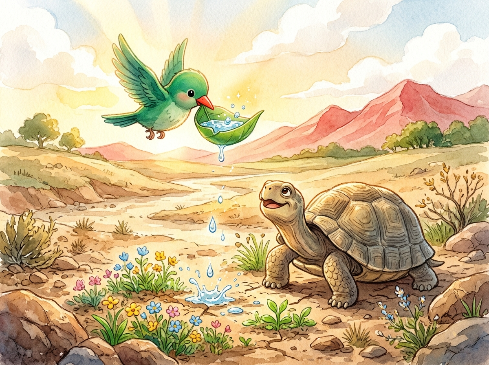

# နှုတ်ခမ်းနီငှက်ကလေး ဖိုးတိုးနှင့် တိမ်မိုးရေဗူး

## ၁။ အစပျိုးခြင်း

နွေဦးရာသီရဲ့ နေခြည်ပြင်းပြင်းက တောင်နီတန်း သစ်တောအုပ်ကြီးတစ်ခုလုံးကို ခြောက်သွေ့ပူပြင်းစေတာပေါ့။ တောအုပ်အလယ်မှာ တစ်ချိန်က အေးမြကြည်လင်စွာ တသွင်သွင် စီးဆင်းခဲ့ဖူးတဲ့ ရွှေစမ်းချောင်းကလေးဟာလည်း အခုအခါ သဲပြင်ဖြူဖြူသာ ကျန်တော့ပြီး ရေတွေ ခန်းခြောက်သွားရှာလေရဲ့။

သစ်ရွက်စိမ်းတွေ ညှိုးရော်ကာ ပန်းပင်လေးတွေ ခေါင်းစိုက်ကျနေချိန်မှာ တောတွင်းတိရစ္ဆာန်လေးတွေဟာ ရေတစ်ပေါက်ရဖို့ အလွန်ပင် မောပန်းဆင်းရဲနေကြရသတဲ့။ အဲဒီတောအုပ်လေးထဲမှာ မျက်လုံးဝိုင်းဝိုင်း၊ နှုတ်ခမ်းနီနီနဲ့ အတောင်ပံ စိမ်းစိမ်းစိုစိုရှိတဲ့ ငှက်စိမ်းကလေး "ဖိုးတိုး" နေထိုင်တာပေါ့။ ဖိုးတိုးဟာ ခန္ဓာကိုယ် သေးငယ်ပေမဲ့ စိတ်ကူးသစ်တွေ အမြဲဖော်ထုတ်တတ်ပြီး စူးစမ်းလိုစိတ် အပြည့်ရှိတဲ့ ငှက်ကလေးပဲ ဖြစ်တယ်။

## ၂။ ဖြစ်စဉ်ပျိုးခြင်း

တစ်မနက်မှာတော့ ဖိုးတိုးဟာ ရေငတ်နေတဲ့ ပန်းပင်လေးတွေနဲ့ စမ်းချောင်းကမ်းနားမှာ မလှုပ်မယှက် နားနေတဲ့ အဘိုးလိပ်ကြီး ဉာဏ်ကြီးကို ငေးကြည့်ရင်း စိတ်မကောင်းဖြစ်မိရှာတယ်။ အဲဒီအချိန်မှာပဲ တောင်နီတန်းရဲ့ အမြင့်မားဆုံး ကျောက်ဆောင်ထိပ်ဆီ မော့ကြည့်လိုက်တော့ အဖြူရောင် တိမ်ခိုးအုံကြီးတွေ ခိုနားနေတာကို ရုတ်တရက် သတိပြုမိသွားတော့တာပဲ။

"ဟော... တောင်ထိပ်ဖျားမှာတော့ တိမ်ဖြူဖြူတွေ ရှိနေပါလား။ တိမ်တွေထဲမှာ ရေစက်ကလေးတွေ အများကြီး ပါတာပေါ့" လို့ ဖိုးတိုး ဝမ်းသာအားရ တွေးမိသတဲ့။

ဖိုးတိုးဟာ တောထဲမှာ ပေါက်နေတဲ့ သဖန်းပင်က ခိုင်ခံ့တဲ့ အရွက်ရင့်ကြီးတစ်ရွက်ကို နှုတ်သီးနဲ့ ညှပ်ယူလိုက်တယ်။ ရေမကျအောင် သစ်ရွက်အစွန်းတွေကို သစ်ပင်စေးနဲ့ သေသေချာချာ ခေါက်ချိုးပြီး ရေခွက်ငယ်လေး ပြုလုပ်လိုက်တာပေါ့။ ပြီးတော့ တောင်ထိပ်က တိမ်ခိုးတွေဆီ အားကြိုးမာန်တက် ပျံသန်းသွားလေရဲ့။

## ၃။ အလှည့်အပြောင်း

တောင်ထိပ်ကို ရောက်တော့ တိမ်ခိုးငွေ့တွေရဲ့ အေးမြတဲ့ အငွေ့အသက်ကို ဝေါခနဲ ခံစားလိုက်ရတယ်။ ဖိုးတိုးဟာ လုပ်ထားတဲ့ သစ်ရွက်ခွက်လေးထဲကို တိမ်ခိုးတွေဆီက ကျလာတဲ့ ရေစက်ကလေးတွေကို တစ်စက်ချင်း စိတ်ရှည်လက်ရှည် ခံယူရှာတာပေါ့။ ရေခွက်ကလေး ပြည့်လာတဲ့အခါ စမ်းချောင်းဝဆီ အသေအချာ သယ်ဆောင်လာပြီး ညှိုးနွမ်းနေတဲ့ ပန်းပင်ငယ်လေးတစ်ပင်ရဲ့ အမြစ်ဆီကို တစ်စက်ချင်း လောင်းချပေးခဲ့တယ်။

အဲဒီမြင်ကွင်းကို သစ်ကိုင်းမြင့်ကြီးပေါ်ကနေ လှမ်းကြည့်နေတဲ့ ရွှေရောင်လင်းယုန် မင်းနောင်က ဟက်ဟက်ပက်ပက် ရယ်မောလိုက်တာပေါ့။

"ဟေး... ဖိုးတိုး၊ မင်း ရူးနေတာလားကွ။ မင်းရဲ့ လက်သည်းခွံလောက် သစ်ရွက်ခွက်ကလေးနဲ့ တစ်ခါသယ်မှ ရေဆယ်စက်လောက်ပဲ ရတာ။ ဒီလို သယ်နေလို့ ဒီစမ်းချောင်းကြီးတစ်ခုလုံး ဘယ်တော့ ရေပြန်ပြည့်မှာလဲ။ မောတာပဲ ဖတ်တင်မယ်၊ သွား... နားနေစမ်းပါ" လို့ လှောင်ပြောင်လိုက်သတဲ့။

နေအပူရှိန်က ပိုပြင်းလာပြီး ဖိုးတိုးရဲ့ အတောင်ပံလေးတွေ ညောင်းညာထုံကျင်လာရှာတယ်။ ဒါပေမဲ့ ဖိုးတိုးကတော့ စိတ်ပျက်အားလျှော့မသွားဘဲ—

"ဦးလင်းယုန် ပြောတာ ဟုတ်ချင်ဟုတ်မှာပေါ့။ ဒါပေမဲ့ ကျွန်တော် ဘာမှမလုပ်ဘဲ ထိုင်ကြည့်နေရင် ဒီပန်းပင်လေးတွေ ဒီနေ့ပဲ သေသွားမှာဗျ။ တစ်စက်ချင်း ဖြစ်ပေမဲ့ ခဏခဏ သယ်ပေးရင် ဒီအပင်လေး အသက်ရှင်နိုင်တာပေါ့" လို့ မျက်နှာမညှိုးတမ်း ပြန်ပြောကာ နောက်တစ်ခေါက် ထပ်မံ ပျံတက်သွားတော့တာပဲ။

## ၄။ အဖြေထွက်ခြင်း

ဖိုးတိုးဟာ နေမဝင်မချင်း တောင်ထိပ်နဲ့ စမ်းချောင်းအကြား အကြိမ်ပေါင်းများစွာ မနားတမ်း ပျံသန်းသယ်ယူခဲ့ရှာတယ်။ မောပန်းပေမဲ့ ဇွဲမလျှော့တဲ့ ဖိုးတိုးရဲ့ အားထုတ်မှုကို အနီးကပ် မြင်နေရတဲ့ အဘိုးလိပ်ကြီး ဉာဏ်ကြီးဟာ အလွန် လေးစားသွားခဲ့တာပေါ့။

အဘိုးလိပ်ကြီးကလည်း စမ်းချောင်းအောက်ခြေက ကျောက်စရစ်ခဲတွေနဲ့ သစ်ခေါက်တွေကို စုစည်းပြီး ရေစက်တွေ မြေထဲ စိမ့်မဝင်အောင် ကန်သင်းငယ်သဖွယ် ကာရံကူညီပေးလေရဲ့။ တစ်စက်ချင်း စုမိလာတဲ့ တိမ်ရေစက်တွေကြောင့် ညနေခင်း ရောက်တော့ ကျောက်ခွက်ငယ်တစ်ခုလုံး ရေကြည်အေးတွေနဲ့ ပြည့်လျှံလာပြီး၊ ညှိုးနွမ်းနေတဲ့ ပန်းပင်လေးတွေဟာ လန်းလန်းဆန်းဆန်း ပြန်လည်ဖူးပွင့်လာတော့တာပဲ။

အဲဒီ ထူးဆန်းတဲ့ အပြောင်းအလဲကို တွေ့တော့ တောအုပ်ထဲက စာကလေးတွေ၊ ချိုးငှက်ကလေးတွေပါ စိတ်လှုပ်ရှားလာကြသတဲ့။

"ငါတို့လည်း ဖိုးတိုးလိုပဲ သစ်ရွက်ကိုယ်စီနဲ့ သယ်ကြမယ်ဟေ့!"

မကြာခင် တောင်နီတန်း ကောင်းကင်ယံမှာ ငှက်ငယ်လေးတွေ ရာနဲ့ချီကာ သစ်ရွက်ခွက်လေးတွေကိုယ်စီနဲ့ တိမ်ရေစက်တွေကို တပျော်တပါး သယ်ယူကြလေရဲ့။ စုပေါင်းအားထုတ်မှုကြောင့် ညဉ့်မနက်မီမှာပဲ ခြောက်သွေ့နေတဲ့ စမ်းချောင်းလေးထဲ ရေကြည်ကြည်တွေ တသွင်သွင် ပြန်လည် စီးဆင်းလာတော့တာပေါ့။

## ၅။ နိဂုံး

ခွန်အားကြီးမားလှပါတယ်ဆိုတဲ့ လင်းယုန်ကြီး မင်းနောင်ပင်လျှင် ငှက်ငယ်လေးတွေရဲ့ ညီညွတ်မှုနဲ့ ဖိုးတိုးရဲ့ မဆုတ်မနစ်တဲ့ ဇွဲလုံ့လကို ငေးမောရင်း အရှက်ရစွာနဲ့ ခေါင်းငုံ့သွားရရှာတယ်။

တောင်နီတန်း သစ်တောအုပ်ကလေးဟာ ပူပြင်းတဲ့ နွေရာသီကို အောင်မြင်စွာ ကျော်လွှားနိုင်ခဲ့ပြီး၊ နှုတ်ခမ်းနီငှက်ကလေး ဖိုးတိုးရဲ့ မဆုတ်မနစ်တဲ့ အားထုတ်မှုကြောင့် သစ်ပင်တိုင်းမှာ အသီးအပွင့်တွေ ဝေဆာစိမ်းလန်းလျက် ကျန်ရစ်ခဲ့တော့တာပေါ့။

---

## သင်ခန်းစာ

ကြီးမားသော အခက်အခဲကို ဖြတ်ကျော်ရာတွင် ကြီးကျယ်သော ခွန်အားရှိမှသာ အောင်မြင်နိုင်သည် မဟုတ်ဘဲ၊ သေးငယ်သော်လည်း မရပ်မနားလုပ်ဆောင်သော ဇွဲလုံ့လကသာ အရာရာကို ပြောင်းလဲစေနိုင်သည်။
