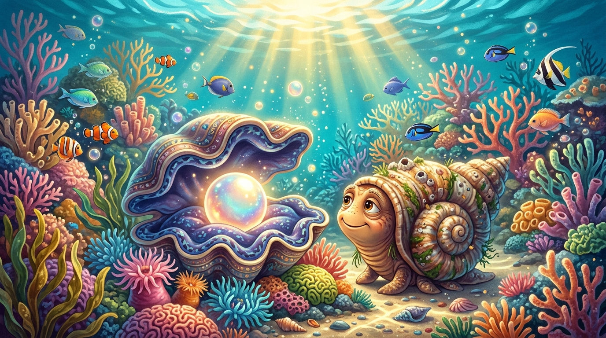

# သန္တာကျောက်တန်းက ယောက်သွားခုံးနှင့် ခရုညို

## ၁။ အစပျိုးခြင်း

ရခိုင်ကမ်းရိုးတန်း သန္တာကျောက်တန်းကြီး အောက်ခြေ၊ လှိုင်းနုနု ဖြတ်စီးနေတဲ့ ပင်လယ်ရေအိုင်လေးထဲမှာ ရေမှော်စိမ်းစိမ်းတွေ လူးလွန့်ကာ ရေပွက်ကလေးတွေ တစီစီ ထနေတတ်တယ်။ အဲဒီကျောက်ခေါင်းထဲမှာ အခွံမာမာ ထူထူနဲ့ ယောက်သွားခုံးလေး "မောင်ခုံး" နေသတဲ့။

မောင်ခုံးက ငယ်ငယ်တုန်းက သဲကြမ်းတစ်မှုန် အခွံထဲ ဝင်စူးဖူးတော့ ဘာကိုမှ မယုံရဲဘူး။ ရေစီးနည်းနည်း လှုပ်တာနဲ့ အခွံနှစ်ချပ်ကို "ဂျွတ်ခနဲ" ပိတ်စေ့ပြီး အမှောင်ထဲ ကုပ်အောင်းနေတတ်တာပေါ့။

သူ့ဘေးနားက ကျောက်ဆောင်ကြားမှာတော့ ပင်လယ်အနှံ့ လျှောက်သွားတတ်တဲ့ ခရုညိုကြီး "ဖိုးခရု" ရှိတယ်။ ဖိုးခရုအခွံပေါ်မှာ လှိုင်းပုတ်ရာ၊ ကျောက်ခြစ်ရာတွေ ပြည့်နေပေမဲ့ သူကတော့ ဘာကိုမှ ကြောက်မနေဘဲ ပျော်ပျော်ပါးပါး နေတတ်ရှာတယ်လေ။

## ၂။ ဖြစ်စဉ်ပျိုးခြင်း

ဒီရေကျချိန် ရောက်တော့ ရေစီးက ရေမှော်မှုန်လေးတွေနဲ့ ပိုးမွှားလေးတွေ သယ်လာပေးတယ်။ တခြား သန္တာပိုးလေးတွေနဲ့ ခရုလေးတွေက ပါးစပ်ဟပြီး အားပါးတရ စားနေကြသတဲ့။

မောင်ခုံးခမျာ ဗိုက်ဆာလွန်းလို့ အူတွေ တလှုပ်လှုပ် မြည်နေပေမဲ့ အခွံကို နည်းနည်းလေးတောင် မဟရဲဘူး။

"ပါးစပ်ဟလိုက်ရင် သဲကြမ်းတွေ ဝင်စူးပြီး နာဦးမှာ။ မစားဘဲ ငြိမ်နေတာပဲ စိတ်ချရတယ်" လို့ တွေးပြီး အခွံကို ပိုတင်းတင်း မာတောင့်တောင့် ပိတ်ထားတော့တာပဲ။

ဖိုးခရုက အနား တွားလာပြီး ခေါင်းတညိတ်ညိတ်နဲ့ သတိပေးရှာတယ်။

"ဟဲ့ မောင်ခုံးရဲ့... မင်း ဒီလို တံခါးပိတ်နေရင် အသက်ရှင်ရုံပဲ ရှိပြီး တဖြည်းဖြည်း အားပြတ်သေသွားမယ်ကွဲ့။ လှိုင်းဒဏ်၊ သဲဒဏ် နည်းနည်းမှ မခံရဲရင် ဘယ်လိုလုပ် ကြီးထွားလာမှာလဲ"

"မဖြစ်ဘူး ဖိုးခရုရယ်... နာမှာ ကျုပ် အရမ်းကြောက်တယ်" ဆိုပြီး မောင်ခုံးက အခွံကို ပြန်စေ့ပစ်လိုက်တယ်။

## ၃။ အလှည့်အပြောင်း

ညနေစောင်းတော့ ပင်လယ်ဘက်က မုန်တိုင်းလှိုင်းကြီးတွေ ဝေါခနဲ တဝေါဝေါ တက်လာပြီး ရေအိုင်ထဲ ဒရဟတ် ဝင်တိုက်တော့တာပဲ။

ရေစီးသန်လွန်းလို့ မောင်ခုံးရဲ့ အခွံစပ်လေး ဟသွားတဲ့ ခဏမှာပဲ စူးရှတဲ့ သဲကြမ်းမှုန်ကြီးတစ်မှုန်က အတွင်းသား ပျော့စိစိလေးထဲ "ဖျစ်ခနဲ" တိုးဝင်သွားပါရော။

မောင်ခုံးခမျာ နာလွန်းလို့ တဆတ်ဆတ် တုန်ပြီး ငိုတော့တာပေါ့။

"အား... နာလိုက်တာ ဖိုးခရုရယ်။ ကျုပ် သေတော့မယ် ထင်ပါရဲ့။ ဒီသဲမှုန်ကြီး အသားထဲ စူးနေပြီဗျ"

မောင်ခုံးက ဒေါသနဲ့ အခွံကို အတင်းညှစ်ရုန်းလေ သဲမှုန်က အသားထဲ ပိုစူးဝင်လေ ဖြစ်နေရှာတယ်။ အဲဒီတော့ ဖိုးခရုက ကျောက်ဆောင်နံရံကနေ လှမ်းအော်ပြောသတဲ့။

"မောင်ခုံး... အတင်း မရုန်းနဲ့ကွဲ့။ စိတ်လျှော့ပြီး မင်းကိုယ်ထဲက အရည်ကြည်လေးတွေနဲ့ အဲဒီသဲမှုန်ကို ညင်ညင်သာသာ ထွေးပတ်ပေးလိုက်စမ်း"

## ၄။ အဖြေထွက်ခြင်း

မောင်ခုံးလည်း နာကျင်တဲ့ကြားက ဖိုးခရု ပြောသလို ကြောက်စိတ်ကို လျှော့ချလိုက်တယ်။

သူ့အတွင်းသား နုနုလေးကနေ အရောင်တလက်လက် တောက်နေတဲ့ အရည်ကြည်လေးတွေ တစိမ့်စိမ့် ထုတ်ပြီး စူးနေတဲ့ သဲမှုန်ကို တစ်လွှာပြီးတစ်လွှာ ညင်ညင်သာသာ ပတ်လွှမ်းပေးနေလိုက်တာပေါ့။

ရက်တွေ လတွေ ကြာလာတော့ စူးရှတဲ့ ဝေဒနာ ပျောက်သွားပြီး သဲမှုန်နေရာမှာ ချောမွတ်လုံးဝန်းတဲ့ အရာလေးတစ်ခု ဖြစ်တည်လာပါလေရော။ မောင်ခုံးလည်း အရင်လို မကြောက်တော့ဘဲ ရေစီးလာတိုင်း အခွံဟပြီး ရေမှော်တွေ ဝဝလင်လင် စားတတ်လာတယ်။

## ၅။ နိဂုံး

တစ်မနက်တော့ နေခြည်နုနု ကျောက်ဆောင်ကြား ထိုးကျလာချိန် မောင်ခုံးဟာ သူ့အခွံကြီးကို အပြည့်အဝ ဖွင့်ဟပြလိုက်သတဲ့။

သူ့အတွင်းသား အလယ်တည့်တည့်မှာ လရောင်လို ဝင်းပပြီး သက်တံ့ရောင် ဖြာနေတဲ့ "ပုလဲလုံးကြီးတစ်လုံး" တလက်လက် တောက်ပနေတော့တာပဲ။

ဖိုးခရုနဲ့ သန္တာကျောက်တန်းက အကောင်လေးတွေ ဝိုင်းအုံကြည့်ပြီး ဟက်ဟက်ပက်ပက် ချီးကျူးကြလေရဲ့။ မောင်ခုံးလည်း ဝင်းပနေတဲ့ ပုလဲလုံးလေးကို ငေးကြည့်ရင်း အေးအေးချမ်းချမ်း ပြုံးလိုက်မိတော့တယ်။

---

## သင်ခန်းစာ

နာမှာကြောက်ပြီး တံခါးပိတ်နေရင် အန္တရာယ်ကင်းရုံပဲ ရှိမယ်၊ ဘာမှ ဖြစ်မလာဘူး။ အခက်အခဲကို ရဲရဲ ရင်ဆိုင်နိုင်မှ တန်ဖိုးရှိတဲ့ အလှတရား ရလာတတ်တယ်။
