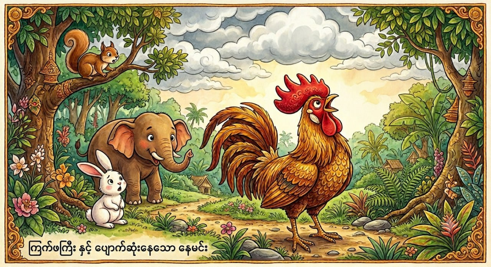

# ကြက်ဖကြီး နှင့် ပျောက်ဆုံးနေသော နေမင်း

## ၁။ အစပျိုးခြင်း

တရံရောအခါက ရွာလေးတစ်ရွာရဲ့ ဘေးမှာ စိမ်းစိုတဲ့ တောအုပ်လေးတစ်ခု ရှိသတဲ့။

အဲ့ဒီတောအုပ်ထဲမှာ “ရွှေကြက်” လို့ခေါ်တဲ့ ကြက်ဖကြီးတစ်ကောင် နေသတဲ့။

ရွှေကြက်ဟာ မနက်တိုင်း အရုဏ်တက်တာနဲ့

“အောက်... အီ... အီး... အွတ်”

လို့ အော်ပြီး နေမင်းကို ကြိုဆိုတတ်တယ်။

ဒါကြောင့် သူက သူ့ကိုယ်သူ အရမ်းအရေးကြီးတယ်လို့ ထင်နေသတဲ့။

“ငါသာ မအော်ရင် နေမင်းတောင် မထွက်လာဘူး”

လို့တောင် တစ်ခါတလေ ကြွားတတ်သေးတယ်။

---

တစ်နေ့ မနက်မှာတော့ ကောင်းကင်တစ်ခုလုံး မိုးတိမ်တွေ ဖုံးနေတယ်။

ရွှေကြက် နိုးလာပြီး ထုံးစံအတိုင်း အော်လိုက်တယ်။

“အောက်... အီ... အီး... အွတ်”

ဒါပေမယ့်...

အရှေ့ဘက်ကို ကြည့်လိုက်တော့ နေမင်းကို မမြင်ရဘူး။

“ဟင်...”

သူ ထပ်ကြည့်တယ်။

မတွေ့ဘူး။

ထပ်ကြည့်တယ်။

မတွေ့သေးဘူး။

## ၂။ ဖြစ်စဉ်ပျိုးခြင်း

ရွှေကြက်ရဲ့ မျက်လုံးတွေ ပြူးသွားတယ်။

“သွားပြီ!”

“နေမင်း ပျောက်သွားပြီ!”

---

ရွှေကြက်က တောထဲကို ပြေးထွက်လာပြီး အော်တော့တာပေါ့။

“အားလုံး ဒုက္ခရောက်ပြီ!”

“နေမင်း ပျောက်သွားပြီ!”

ယုန်ကလေးက မုန်လာဥစားနေရင်း လန့်သွားတယ်။

“တကယ်လား?”

ရှဉ့်ကလေးကလည်း သစ်ကိုင်းပေါ်ကနေ လှမ်းမေးတယ်။

“ဘယ်သူ ခိုးသွားတာလဲ?”

ရွှေကြက်က ခေါင်းခါတယ်။

“မသိဘူး... ဒါပေမယ့် ငါလိုက်ရှာမယ်!”

---

အရင်ဆုံး သူတို့ဟာ မြေခွေးဆီ သွားကြတယ်။

မြေခွေးက အပင်အောက်မှာ အိပ်နေတုန်း။

“ဟေ့... မြေခွေး!”

“နေမင်းကို မင်းယူထားလား?”

မြေခွေးက မျက်လုံးတစ်ဖက် ဖွင့်ပြီး ကြည့်တယ်။

“ဘာ?”

## ၃။ အလှည့်အပြောင်း

“ငါက နေမင်းကို ဘာလုပ်ရမှာလဲ?”

“စားလို့မှ မရတာ...”

ပြီးတော့ ပြန်အိပ်သွားတယ်။

---

နောက်တော့ ဆင်ကြီးဆီ သွားတယ်။

ဆင်ကြီးက ရေချိုးနေတုန်း။

“ဆင်ကြီး!”

“နေမင်းကို တွေ့မိသေးလား?”

ဆင်ကြီးက စဉ်းစားတယ်။

“မနေ့ကတော့ တွေ့တယ်...”

“ဒီနေ့တော့ မတွေ့ဘူး...”

ရွှေကြက်က ချက်ချင်း ခုန်လိုက်တယ်။

“ဒါဆို တကယ်ပျောက်ပြီပေါ့!”

ဆင်ကြီးက မျက်မှောင်ကြုတ်ပြီး

“ငါက ရေချိုးနေတာ... ဘယ်လိုသိမှာလဲ...”

လို့ ပြောလိုက်တယ်။

---

နေ့လယ်ရောက်တော့ တောတစ်ပတ်လုံး ပတ်ပြီးသွားပြီ။

နေမင်းကို မတွေ့သေးဘူး။

ရွှေကြက်လည်း စိတ်ညစ်လာတယ်။

## ၄။ အဖြေထွက်ခြင်း

“နေမင်း မရှိတော့ရင် ဘာဖြစ်မလဲ...”

“ကမ္ဘာကြီး မှောင်သွားမလား...”

“ငါ့တာဝန် မကျေဘူးထင်တယ်...”

လို့ တွေးပြီး ဝမ်းနည်းနေတယ်။

---

အဲ့ဒီအချိန်မှာ ဇီးကွက်အိုကြီးတစ်ကောင် ပျံလာတယ်။

“ဘာတွေ ရှုပ်နေတာလဲ...”

လို့ မေးတယ်။

ရွှေကြက်က ဖြစ်သမျှ အကုန်ပြောပြလိုက်တယ်။

ဇီးကွက်အိုကြီးက နားထောင်ပြီး ရယ်လိုက်တယ်။

“ဟား... ဟား... ဟား...”

“နေမင်း မပျောက်ပါဘူးကွယ်...”

“မိုးတိမ်တွေ ကာထားလို့ မမြင်ရတာပါ...”

ရွှေကြက်က မယုံဘူး။

“တကယ်လား?”

“တကယ်ပေါ့”

“ခဏစောင့်ကြည့်လိုက်”

---

ညနေဘက် ရောက်လာတော့ လေက တဖြည်းဖြည်း တိုက်လာတယ်။

မိုးတိမ်တွေ တရွေ့ရွေ့ လွင့်သွားတယ်။

## ၅။ နိဂုံး

ခဏကြာတော့...

ရွှေရောင် အလင်းတန်းကြီးတစ်ခု ကောင်းကင်ပေါ်က ထွက်လာတယ်။

“ဟာ...”

“နေမင်း!”

ရွှေကြက်က ဝမ်းသာလွန်းလို့ ခုန်ပေါက်နေတယ်။

ယုန်ကလေးက ရယ်တယ်။

ရှဉ့်ကလေးက ရယ်တယ်။

ဆင်ကြီးတောင် ရယ်မိတယ်။

“တစ်နေ့လုံး လိုက်ရှာနေတာ မိုးတိမ်နောက်မှာ ရှိနေတာပဲ!”

---

ရွှေကြက်က ရှက်သွားပေမယ့် သူလည်း ရယ်လိုက်တယ်။

“နောက်တစ်ခါ မသေချာဘဲ မအော်တော့ဘူး...”

လို့ ပြောလိုက်သတဲ့။

အဲ့ဒီနေ့ကစပြီး တောထဲက တိရစ္ဆာန်တွေဟာ

တစ်ခုခု ဖြစ်လာတိုင်း

“နေမင်းပျောက်ပြန်ပြီလား?”

ဆိုပြီး ရွှေကြက်ကို စနောက်ကြတော့သတဲ့။

ရွှေကြက်ကလည်း မစိတ်ဆိုးတော့ဘဲ

တဟားဟား ရယ်နေတတ်သတဲ့။ ☀️🐓

---

---

## သင်ခန်းစာ

မိမိ မျက်စိဖြင့် တစ်စိတ်တစ်ပိုင်း မြင်ရရုံမျှဖြင့် အလောတကြီး ကောက်ချက်မချသင့်ပေ။ စိုးရိမ်ထိတ်လန့်မှု မဖြစ်မီ အခြေအနေမှန်ကို စိတ်အေးချမ်းစွာ စိစစ်မေးမြန်းခြင်းကသာ အမှားကို ကာကွယ်နိုင်သည်။
