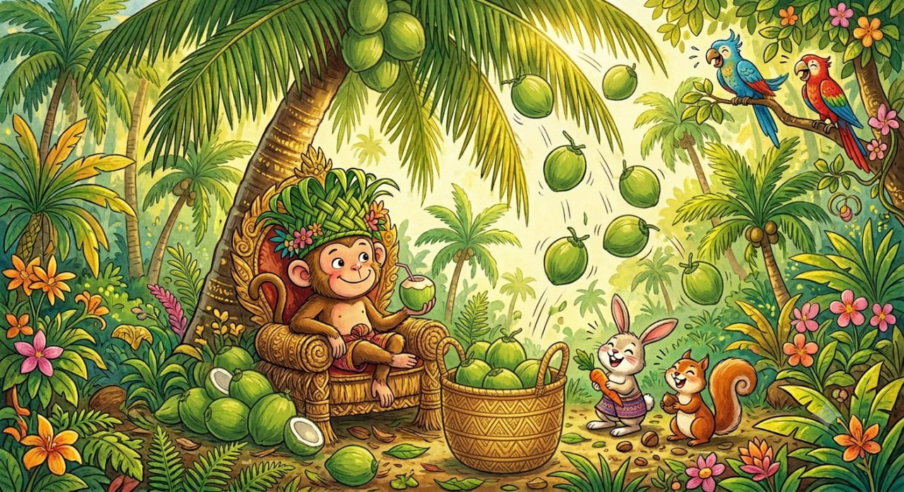

# မျောက်ကလေး နှင့် အုန်းသီး

## ၁။ အစပျိုးခြင်း

တရံရောအခါက တောအုပ်စိမ်းစိမ်းလေးတစ်ခုထဲမှာ မောင်ရွှေမျောက်လို့ ခေါ်တဲ့ မျောက်ကလေးတစ်ကောင် နေသတဲ့။

သူက တောထဲမှာ အဆော့ဆုံး၊ အစားပုပ်ဆုံး မျောက်ကလေးလည်း ဖြစ်တယ်။

ဒါပေမယ့် သူ့မှာ ထူးခြားတာတစ်ခုတော့ ရှိသတဲ့။

အဲ့ဒါကတော့...

အုန်းသီး အရမ်းကြိုက်တာပဲ။

မနက်စာ အုန်းသီး။

နေ့လယ်စာ အုန်းသီး။

ညစာလည်း အုန်းသီး။

တစ်နေ့ကို အုန်းသီး ဘယ်နှစ်လုံး စားလဲဆိုတာ သူကိုယ်တိုင်တောင် မမှတ်မိတော့ဘူး။

---

တစ်နေ့မှာတော့ မောင်ရွှေမျောက်ဟာ အုန်းပင်အမြင့်ကြီးတစ်ပင်ပေါ် တက်ခူးပြီး အုန်းသီးစားနေသတဲ့။

အဲ့ဒီအချိန်မှာ...

"ဒုန်း!"

အုန်းသီးတစ်လုံး ပြုတ်ကျပြီး သူ့ခေါင်းကို တည့်တည့်ထိသွားတယ်။

"အမလေး!"

မောင်ရွှေမျောက် ခေါင်းကိုပွတ်ရင်း ထိုင်ချလိုက်တယ်။

ခဏလောက်ကြာတော့ သူ့စိတ်ထဲမှာ ထူးဆန်းတဲ့ အတွေးတစ်ခု ပေါ်လာသတဲ့။

"အုန်းသီးတွေ နေရာအများကြီးရှိတဲ့ထဲက ငါ့ခေါင်းပေါ်ကိုမှ လာကျတာ..."

"ဒါ သာမန်ကိစ္စ မဟုတ်ဘူး..."

## ၂။ ဖြစ်စဉ်ပျိုးခြင်း

"ငါ့ကို ရွေးချယ်လိုက်တာပဲ ဖြစ်ရမယ်..."

အဲ့လိုတွေးရင်း မျက်လုံးတွေ တောက်လာတယ်။

"ဟုတ်ပြီ!"

"ငါဟာ အုန်းသီးဘုရင်ပဲ!"

ဆိုပြီး သူ့ကိုယ်သူ အုန်းသီးဘုရင်လို့ ကြေညာလိုက်တယ်။

---

နောက်တစ်နေ့ မနက်မှာတော့ မောင်ရွှေမျောက်က တောထဲကို ထွက်လာပြီး အော်ပြောတော့တယ်။

"နားထောင်ကြ!"

"ယနေ့မှစပြီး ငါဟာ အုန်းသီးဘုရင် ဖြစ်ပြီ!"

ယုန်ကလေးက မုန်လာဥဝါးနေရင်း မေးလိုက်တယ်။

"ဘယ်သူက ဘုရင်တင်မြှောက်လိုက်တာလဲ?"

"အုန်းသီး!"

"ဟင်?"

"မနေ့က ငါ့ခေါင်းပေါ် ကျတဲ့ အုန်းသီး!"

ယုန်ကလေးက ခဏလောက် ငြိမ်သွားပြီး...

"အဲ့ဒါက မတော်တဆ ကျတာ မဟုတ်ဘူးလား?"

လို့ မေးလိုက်တယ်။

ဒါပေမယ့် မောင်ရွှေမျောက်က မယုံဘူး။

"မဟုတ်ဘူး!"

## ၃။ အလှည့်အပြောင်း

"ဒါဟာ အမှတ်အသားပဲ!"

---

အဲ့ဒီနေ့ကစပြီး မောင်ရွှေမျောက်က ဘုရင်လို နေတော့တယ်။

အုန်းရွက်တွေနဲ့ သရဖူလုပ်တယ်။

အုန်းခွံကြီးကို ပလ္လင်လုပ်တယ်။

အုန်းရည်ကို ရွှေခွက်မရှိလို့ အုန်းခွံထဲ ထည့်သောက်တယ်။

ဘယ်သွားသွားလည်း...

"ဘုရင်ကြီး လာပြီ!"

လို့ ကိုယ့်ဘာသာ ကြေညာပြီး သွားတယ်။

တိရစ္ဆာန်တွေကတော့ မျက်နှာလွှဲပြီး ရယ်နေကြတာပေါ့။

---

ရက်အနည်းငယ်ကြာတော့ မောင်ရွှေမျောက်က ပိုပြီး အရှိန်တက်လာတယ်။

"ဘုရင်ဆိုတော့ အခွန်ကောက်ရမယ်!"

လို့ ပြောတယ်။

"ယုန်ကလေး..."

"ဘာပေးရမလဲ?"

"အုန်းသီး နှစ်လုံး!"

"ကျွန်တော်က အုန်းပင်တောင် မတက်တတ်ဘူးလေ!"

"အဲ့ဒါ ငါ မသိဘူး!"

😭

## ၄။ အဖြေထွက်ခြင်း

ယုန်ကလေး စိတ်ညစ်သွားတယ်။

ရှဉ့်ကလေးလည်း စိတ်ညစ်တယ်။

ငှက်ကလေးတွေလည်း စိတ်ညစ်ကြတယ်။

ဒါပေမယ့် ဘာမှ ပြန်မပြောကြဘူး။

---

တစ်နေ့မှာတော့ လေပြင်းကြီး တိုက်လာတယ်။

သစ်ကိုင်းတွေ ယိမ်းယိုင်နေတယ်။

အုန်းပင်တွေ လှုပ်ခါနေတယ်။

မောင်ရွှေမျောက်ကတော့ သူ့ပလ္လင်ပေါ်မှာ ထိုင်ပြီး

"ငါ့နိုင်ငံကို ဘာမှ မခိုက်နိုင်ပါဘူး!"

လို့ ပြောနေသတဲ့။

အဲ့ဒီအချိန်မှာ...

"ဒုန်း!"

အုန်းသီးတစ်လုံး ကျတယ်။

"ဒုန်း!"

နောက်တစ်လုံး ကျတယ်။

"ဒုန်း! ဒုန်း! ဒုန်း!"

အုန်းသီးတွေ တဝုန်းဝုန်း ပြုတ်ကျလာတော့တယ်။

မောင်ရွှေမျောက်လည်း ထပြေးရတော့တာပေါ့။

## ၅။ နိဂုံး

---

အဲ့ဒါကို မြင်တော့ ယုန်ကလေးက ရယ်ပြီး ပြောလိုက်တယ်။

"မောင်ရွှေမျောက်..."

"ဘာလဲ?"

"မင်းကို အုန်းသီးတစ်လုံး ကျလို့ ဘုရင်ဖြစ်တာဆို..."

"ဟုတ်တယ်လေ!"

"အခု အုန်းသီး အလုံးနှစ်ဆယ်လောက် ကျတယ်..."

"အင်း..."

"ဒါဆို ဒီနေ့ ဘုရင်အသစ် အယောက်နှစ်ဆယ် ပေါ်လာပြီပေါ့?"

😭

တောထဲက တိရစ္ဆာန်တွေ အားလုံး တဟားဟား ရယ်ကြတော့တယ်။

မောင်ရွှေမျောက်လည်း ဘာပြန်ပြောရမှန်း မသိတော့ဘူး။

---

ခဏလောက်ကြာတော့ သူက ခေါင်းကုတ်ပြီး ပြုံးလိုက်တယ်။

"ဟဲဟဲ ဟုတ်သားပဲ..."

"ငါ နည်းနည်း အတွေးလွန်သွားတာပဲ..."

အဲ့ဒီနေ့ကစပြီး မောင်ရွှေမျောက်ဟာ အုန်းသီးဘုရင် မလုပ်တော့ဘူး။

ဒါပေမယ့်...

အုန်းသီးတော့ ဆက်စားနေတုန်းပဲတဲ့။ 😄🥥

---

---

## သင်ခန်းစာ

သာမန်သဘာဝ အဖြစ်အပျက်ကို အံ့ဖွယ်ထူးခြားသည်ဟု ထင်ယောင်ထင်မှားဖြစ်ကာ မာနထောင်လွှားမနေသင့်ပေ။ လက်တွေ့ကျသော အသိပညာဖြင့် ဆင်ခြင်ခြင်းကသာ အမှန်တရားကို မျက်ဝါးထင်ထင် တွေ့မြင်စေသည်။
