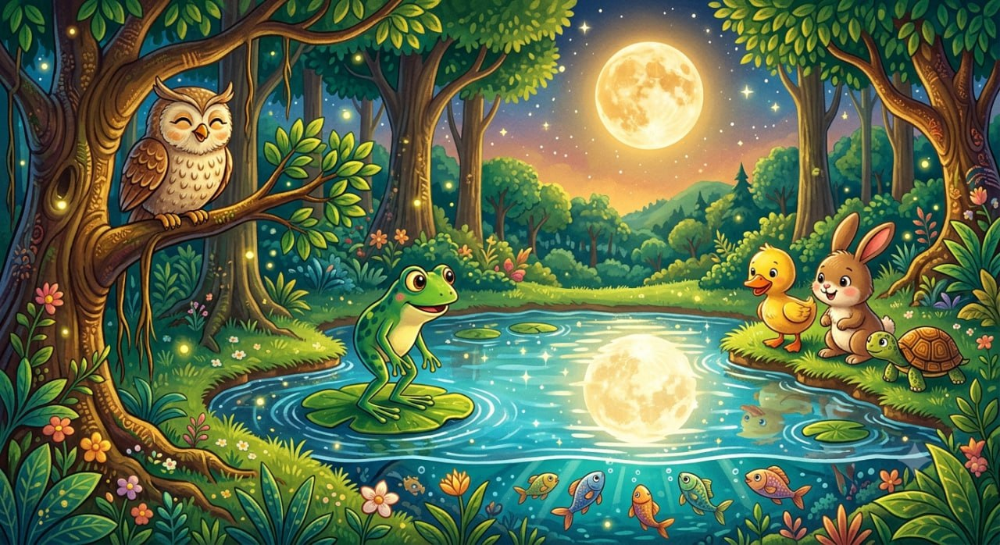

# ဖားကလေး နှင့် လမင်းဖမ်းပွဲ

## ၁။ အစပျိုးခြင်း

တရံရောအခါက စိမ်းလန်းတဲ့ တောအုပ်လေးတစ်ခုထဲမှာ ရေကန်အကြီးကြီးတစ်ကန် ရှိသတဲ့။

အဲ့ဒီရေကန်ဘေးမှာ "ဖိုးဖား" လို့ခေါ်တဲ့ ဖားကလေးတစ်ကောင် နေသတဲ့။

ဖိုးဖားက စိတ်ကောင်းရှိတယ်။

ဒါပေမယ့်...

အတွေးနည်းနည်းမြန်တယ်။

တစ်ခုခုတွေ့တာနဲ့ 
သေချာမစဉ်းစားဘဲ အမြန်အဆန် ဆုံးဖြတ်ပြီး လုပ်တတ်တဲ့အကျင့်လည်း ရှိသတဲ့။

---

လပြည့်ညတစ်ညမှာ...

ဖိုးဖားက ရေကန်ဘေးမှာ ထိုင်ပြီး လေညင်းခံနေတယ်။

အဲ့ဒီအချိန်မှာ ရေကန်ထဲကို ငုံ့ကြည့်လိုက်တော့...

လမင်းကြီးကို တွေ့လိုက်ရတယ်။

လုံးလုံးဝန်းဝန်း ဝိုင်းဝိုင်းလေး။

ရေထဲမှာ ငြိမ်ငြိမ်လေး ပေါ်နေသတဲ့။

ဖိုးဖားက မျက်လုံးပြူးသွားတယ်။

"ဟင်..."

"လမင်း ရေထဲကျနေပါလား!"

---

ဖိုးဖားက ချက်ချင်း အော်လိုက်တယ်။

"ကယ်ကြပါဦး!"

## ၂။ ဖြစ်စဉ်ပျိုးခြင်း

"လမင်း ရေထဲပြုတ်ကျနေပြီ!"

အသံကြားတော့ ဘဲကလေး ပြေးလာတယ်။

"ဘယ်မှာလဲ?"

ဖိုးဖားက ရေကန်ကို လက်ညှိုးထိုးပြတယ်။

"ဟိုမှာ!"

ဘဲကလေးလည်း ငုံ့ကြည့်လိုက်တော့...

"ဟုတ်သားပဲ!"

"လမင်းကြီး ရေထဲရောက်နေပြီ!"

---

ခဏအကြာမှာ...

လိပ်ကလေးလည်း ရောက်လာတယ်။

ငါးကလေးတွေလည်း ရောက်လာတယ်။

ယုန်ကလေးလည်း ရောက်လာတယ်။

အားလုံး ရေကန်ထဲကို ငုံ့ကြည့်ပြီး

"တကယ်ပဲ!"

"လမင်းကို မြန်မြန်ကယ်ရမယ်!"

လို့ ပြောကြတော့တယ်။

---

ဖိုးဖားက အကြံထုတ်လိုက်တယ်။

## ၃။ အလှည့်အပြောင်း

"ဘဲက ရေကူးတတ်တယ်။"

"ငါးကလည်း ရေထဲမှာ နေတယ်။"

"အတူတူဆင်းပြီး လမင်းကို တွန်းတင်ကြရအောင်!"

"ကောင်းတယ်!"

အားလုံး သဘောတူလိုက်ကြတယ်။

---

ဘဲကလေးက ရေထဲကို ခုန်ဆင်းတယ်။

"ဝုန်း!"

ငါးကလေးတွေလည်း ရေကူးသွားကြတယ်။

ဖိုးဖားကလည်း နောက်ကလိုက်တယ်။

ဒါပေမယ့်...

လမင်းက ဖမ်းလို့မရဘူး။

ဖမ်းမယ်ဆိုရင် ဟိုဘက်ရွှေ့သွားတယ်။

ဒီဘက်သွားရင် ဒီဘက်ရွှေ့သွားတယ်။

ဘယ်လိုမှ မမိဘူး။

---

ဖိုးဖားက မလျှော့သေးဘူး။

"အားလုံးဝိုင်းဖမ်းကြ!"

ဆိုပြီး အော်လိုက်တယ်။

## ၄။ အဖြေထွက်ခြင်း

အဲ့ဒီတော့...

ဘဲကလေးလည်း ရုန်းတယ်။

ငါးကလေးတွေလည်း ရုန်းတယ်။

ဖိုးဖားလည်း ရုန်းတယ်။

ရေကန်တစ်ကန်လုံး လှိုင်းတွေ ထသွားတော့တယ်။

ခဏအကြာမှာ...

"ဟင်..."

"လမင်း ဘယ်ရောက်သွားတာလဲ?"

ရေကန်ထဲမှာ လမင်းကို မမြင်ရတော့ဘူး။

ဖိုးဖားက မျက်နှာငယ်လေးနဲ့ ပြောတယ်။

"ငါတို့ နောက်ကျသွားပြီထင်တယ်..."

---

အဲ့ဒီအချိန်မှာ...

ရေကန်ဘေးက သစ်ပင်ပေါ်မှာ နေတဲ့ ဇီးကွက်အိုကြီးက ရယ်လိုက်တယ်။

"ဟား... ဟား... ဟား..."

ဖိုးဖားက မော့ကြည့်တယ်။

"ဘာရယ်တာလဲ အဘဇီးကွက်?"

ဇီးကွက်အိုကြီးက ကောင်းကင်ကို လက်ညှိုးထိုးပြတယ်။

"ဟိုမှာ ကြည့်လိုက်ပါဦး..."

## ၅။ နိဂုံး

အားလုံး မော့ကြည့်လိုက်တော့...

လမင်းကြီးက ကောင်းကင်ပေါ်မှာ ဝင်းထိန်ပြီး လင်းနေတယ်။

ဖိုးဖားတို့ အားလုံး ပါးစပ်အဟောင်းသား ဖြစ်သွားကြတယ်။

ဇီးကွက်အိုကြီးက ပြုံးပြီး ပြောတယ်။

"ရေထဲမှာ မြင်ရတာက..."

"လမင်းရဲ့ အရိပ်ပါကွ..."

---

ဖိုးဖားက ခေါင်းကုတ်ရင်း ရယ်လိုက်တယ်။

"ဟီး... ဟီး..."

"ငါတော့ အလန့်တကြား ဖြစ်သွားတာပဲ..."

ဘဲကလေးလည်း ရယ်တယ်။

ငါးကလေးတွေလည်း ရယ်တယ်။

ယုန်ကလေးလည်း ရယ်တယ်။

အဲ့ဒီညက ရေကန်ဘေးမှာ ရယ်သံတွေ ဆူညံနေတော့သတဲ့။

ဒါပေမယ့်...

ဖိုးဖားကတော့ နောက်နေ့ကစပြီး ရေကန်ထဲမှာ လမင်းပေါ်လာတိုင်း...

အရင်လို ပြေးမဆင်းတော့ဘူး။

အပေါ်ကို အရင်မော့ကြည့်တတ်သွားသတဲ့။ 🌕

---

---

## သင်ခန်းစာ

ရေပြင်ပေါ်က အရိပ်ကို အစစ်အမှန်ဟု အထင်မမှားသင့်သကဲ့သို့ အပေါ်ယံ မြင်ကွင်းတိုင်းကို မဆင်မခြင် မယုံကြည်သင့်ပေ။ အရာရာကို အမှန်တကယ် လက်တွေ့စူးစမ်းပြီးမှသာ ဆုံးဖြတ်ချက်ချသင့်သည်။
