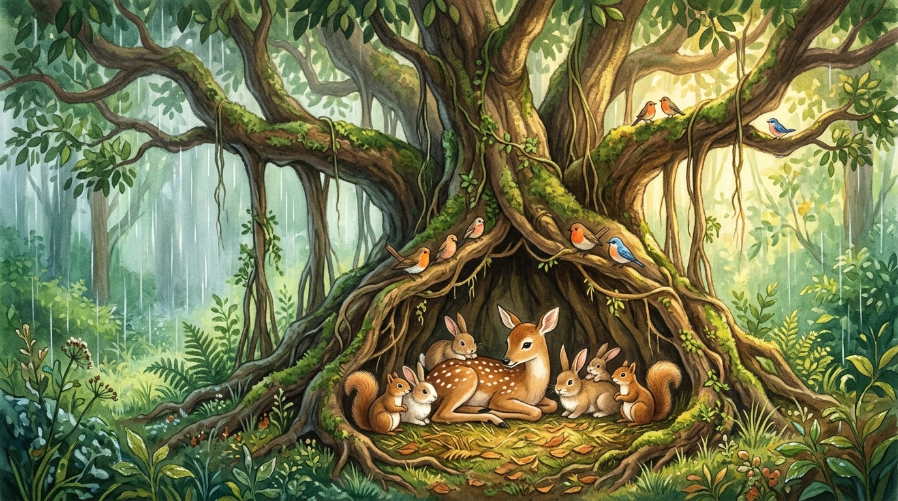

# သစ်ပင်အိုကြီးအောက်က ကြင်နာမှု

## ၁။ အစပျိုးခြင်း

တရံရောအခါက တောအုပ်ကြီးတစ်ခုရဲ့ အလယ်မှာ သစ်ပင်အိုကြီးတစ်ပင် ရှိသတဲ့။

အဲ့ဒီသစ်ပင်ကြီးဟာ အလွန်ကြီးမားပြီး အကိုင်းအခက်တွေကလည်း အဝေးကြီးအထိ ဖြန့်ကားနေတယ်။ နွေရာသီမှာ အရိပ်ရတယ်။ မိုးရွာရင်လည်း မိုးခိုလို့ရတယ်။ ငှက်ကလေးတွေ အသိုက်ဖွဲ့ကြတယ်။ ရှဉ့်ကလေးတွေကလည်း အကိုင်းပေါ်မှာ ပြေးလွှားဆော့ကစားကြတယ်။

သစ်ပင်အောက်မှာတော့ "မောင်ညို" လို့ခေါ်တဲ့ ယုန်ကလေးတစ်ကောင် နေထိုင်သတဲ့။

မောင်ညိုဟာ ဆင်းရဲပေမယ့် စိတ်ထားအလွန်ကောင်းသူ ဖြစ်တယ်။

သူ့မှာ စားစရာ နည်းနည်းပဲရှိရင်တောင် တခြားသူတွေ ဗိုက်ဆာနေတာမြင်ရင် ခွဲဝေပေးတတ်သတဲ့။

တစ်နေ့မှာ သူ့အမေက ပြောတယ်။

"သားရေ... သူများကို ကူညီတာ ကောင်းပါတယ်။ ဒါပေမယ့် သားမှာလည်း စားဖို့၊ နေဖို့ လိုသေးတယ်နော်။"

မောင်ညိုက ပြုံးပြီး ပြန်ပြောတယ်။

"ဟုတ်ကဲ့ အမေ။ သားသိပါတယ်။ ဒါပေမယ့် ကိုယ်တတ်နိုင်တဲ့ အကူအညီလေးတစ်ခုက သူများအတွက် အရမ်းအဖိုးတန်နေနိုင်တယ် မဟုတ်လား။"

အမေယုန်က သားလေးရဲ့ ခေါင်းကို ပွတ်ပေးလိုက်တယ်။

## မမျှော်လင့်ထားတဲ့ ဧည့်သည်

တစ်နေ့ ညနေခင်းမှာ မောင်ညိုဟာ တောလမ်းလေးအတိုင်း လမ်းလျှောက်လာရင်း သစ်ပင်အောက်မှာ တစ်ကောင်ကောင် လဲနေသံ ကြားလိုက်ရတယ်။

သွားကြည့်လိုက်တော့...

အရမ်းပင်ပန်းပြီး ရေငတ်နေတဲ့ မြေခွေးအိုကြီးတစ်ကောင် ဖြစ်နေတယ်။

## ၂။ ဖြစ်စဉ်ပျိုးခြင်း

မြေခွေးဆိုတာ ယုန်တွေရဲ့ သဘာဝရန်သူပဲ မဟုတ်လား။

မောင်ညိုလည်း အစပိုင်းမှာ ကြောက်သွားတယ်။

"ငါ သူ့ကို ကူညီလိုက်ရင် ငါ့ကို စားမလား..."

လို့ တွေးမိတယ်။

ဒါပေမယ့် မြေခွေးအိုကြီးကတော့ အသံတိုးတိုးလေးနဲ့ ပြောတယ်။

"ရေ... ရေနည်းနည်းလောက် ရနိုင်မလားကွယ်..."

မောင်ညိုက ခဏစဉ်းစားပြီး သူ့အိမ်က ရေခွက်လေးကို ပြေးယူလာခဲ့တယ်။

"ဒီမှာ သောက်ပါဦး အဘိုး။"

မြေခွေးအိုကြီးက ရေကို ဖြည်းဖြည်းချင်း သောက်လိုက်တယ်။

"ကျေးဇူးတင်ပါတယ်ကွယ်။ ငါ့ကို မကြောက်ဘူးလား။"

မောင်ညိုက ပြန်ပြောတယ်။

"ကြောက်တာပေါ့ အဘိုးရယ်။ ဒါပေမယ့် ရေငတ်နေတဲ့သူကို ရေတိုက်တာတော့ မမှားဘူးထင်လို့ပါ။"

မြေခွေးအိုကြီးဟာ ဘာမှပြန်မပြောနိုင်တော့ဘဲ မျက်ရည်လေး ဝဲလာတယ်။

## ကြင်နာမှုက ဆက်လက်ပျံ့နှံ့လာတယ်

နောက်တစ်နေ့မှာတော့ မောင်ညိုဟာ သစ်သီးလေးတွေ ကောက်နေတုန်း တောင်ပံဒဏ်ရာရနေတဲ့ ငှက်ကလေးတစ်ကောင်ကို တွေ့တယ်။

## ၃။ အလှည့်အပြောင်း

သူက ငှက်ကလေးကို အိမ်ပြန်ခေါ်လာပြီး အရွက်နုလေးတွေနဲ့ အိပ်ရာလုပ်ပေးတယ်။

ရက်အနည်းငယ်ကြာတော့ ငှက်ကလေး ပြန်ပျံနိုင်သွားတယ်။

"ကျေးဇူးတင်ပါတယ် မောင်ညို။ မင်းရဲ့ ကျေးဇူးကို ငါ မမေ့ပါဘူး။"

မောင်ညိုက ရယ်ပြီး ပြောတယ်။

"အဆင်ပြေသွားရင် ပြီးတာပါပဲ။ ကျေးဇူးပြန်ဆပ်ဖို့ မလိုပါဘူး။"

အဲ့ဒီနောက် ငှက်ကလေးဟာ တောထဲက တခြားငှက်တွေကို မောင်ညိုအကြောင်း ပြောပြသတဲ့။

မကြာခင်မှာပဲ တောထဲက တိရစ္ဆာန်တွေဟာ မောင်ညိုရဲ့ ကြင်နာတတ်တဲ့ စိတ်ထားကို သိလာကြတယ်။

တချို့က သူ့ကို သစ်သီးလာပေးကြတယ်။ တချို့က သူ့အိမ်ရှေ့က သစ်ကိုင်းခြောက်တွေ ရှင်းပေးကြတယ်။

မောင်ညိုကတော့ အဲ့ဒါတွေကို ဘယ်တုန်းကမှ မတောင်းဆိုခဲ့ဘူး။

## တောအုပ်ကြီးရဲ့ အခက်အခဲ

တစ်နှစ်မှာတော့ တောထဲမှာ မိုးမရွာတာ ကြာလွန်းလို့ ချောင်းတွေ ခန်းခြောက်လာတယ်။

ရေကန်လေးတွေလည်း တဖြည်းဖြည်း ခန်းလာတယ်။

တိရစ္ဆာန်တွေ အားလုံး ရေရှာဖို့ အခက်တွေ့နေကြတယ်။

တစ်နေ့မှာတော့ သစ်ပင်အိုကြီးအောက်က မြေပြင်ဟာ ရုတ်တရက် အက်ကွဲလာတယ်။

## ၄။ အဖြေထွက်ခြင်း

သစ်ပင်ကြီးရဲ့ အမြစ်တွေ ခြောက်သွေ့လာပြီး အကိုင်းအခက်တွေပါ ညှိုးနွမ်းလာတော့တယ်။

"သစ်ပင်ကြီး သေတော့မှာလား..."

ငှက်ကလေးတွေက ဝမ်းနည်းနေကြတယ်။

သစ်ပင်ကြီးဟာ သူတို့ရဲ့ အိမ်ဖြစ်သလို တောထဲက တိရစ္ဆာန်အားလုံးအတွက် အရိပ်အာဝါသလည်း ဖြစ်တယ်။

မောင်ညိုက သစ်ပင်ကြီးကို ကြည့်ပြီး ပြောလိုက်တယ်။

"ငါတို့ အားလုံး စုပေါင်းပြီး ကယ်ကြရအောင်။"

တိရစ္ဆာန်တချို့က ချက်ချင်း သဘောတူကြတယ်။

ဆင်ကြီးက အဝေးက ရေကို နှာမောင်းနဲ့ သယ်လာတယ်။

မျောက်ကလေးတွေက ရေရှိတဲ့နေရာကို ရှာဖွေကြတယ်။

ငှက်ကလေးတွေက အစေ့အဆန်တွေ ယူလာကြတယ်။

ရှဉ့်ကလေးတွေက သစ်ပင်ခြေရင်းက မြေသားတွေကို ဖယ်ရှားပေးကြတယ်။

မြေခွေးအိုကြီးကလည်း သူ့အင်အားရှိသလောက် ကူညီပေးတယ်။

အားလုံး အတူတကွ ကြိုးစားကြတာပေါ့။

## မေတ္တာရဲ့ အကျိုး

ရက်အနည်းငယ်ကြာတော့ မိုးကြီးတစ်ခါ ရွာချလိုက်တယ်။

## ၅။ နိဂုံး

တောအုပ်ကြီးတစ်ခုလုံး စိုစွတ်လန်းဆန်းသွားတယ်။

သစ်ပင်အိုကြီးလည်း ရေတွေစုပ်ယူပြီး အရွက်သစ်လေးတွေ ပြန်ထွက်လာတယ်။

တိရစ္ဆာန်အားလုံး ဝမ်းသာအားရ အော်ဟစ်ကြတယ်။

အဲ့ဒီအချိန်မှာ မြေခွေးအိုကြီးက မောင်ညိုနားကို လာပြီး ပြောတယ်။

"မောင်ညိုရေ... မင်းသာ အရင်တုန်းက ငါ့ကို ရေမတိုက်ခဲ့ရင် ငါ ဒီနေ့ ဒီမှာ ရှိနေမှာ မဟုတ်ဘူး။ ဒီနေ့ ငါတို့အားလုံး ဒီသစ်ပင်ကြီးကို ကယ်နိုင်ခဲ့တာလည်း မင်းရဲ့ ကြင်နာမှုကြောင့်ပါပဲ။"

မောင်ညိုက ပြုံးလိုက်တယ်။

"ကျွန်တော်တစ်ယောက်တည်း လုပ်ခဲ့တာမှ မဟုတ်တာ အဘိုးရယ်။ အားလုံးက ဝိုင်းကူခဲ့ကြလို့ပါ။"

သစ်ပင်အိုကြီးဟာ လေညင်းလေးတိုက်ခတ်လာတာနဲ့အမျှ အရွက်တွေကို တဖြည်းဖြည်း လှုပ်ခါနေတယ်။

အဲ့ဒီအရွက်လှုပ်သံလေးဟာ တိရစ္ဆာန်အားလုံးကို ကျေးဇူးတင်နေသလိုပါပဲ။

အဲ့ဒီနေ့ကစပြီး သစ်ပင်အိုကြီးအောက်မှာ တိရစ္ဆာန်လေးတွေ အားလုံး အတူတကွ နေထိုင်ကြတော့တယ်။

တစ်ကောင်နဲ့တစ်ကောင် မတူကြပေမယ့် တစ်ကောင်အခက်အခဲဖြစ်ရင် ကျန်တဲ့သူတွေက ဝိုင်းကူကြတယ်။

မောင်ညိုကတော့ သူ့အမေကို ပြုံးပြီး ပြောလိုက်တယ်။

"အမေ... သားပေးခဲ့တဲ့ ရေတစ်ခွက်က ဒီနေ့ တောအုပ်ကြီးအတွက် အရိပ်အာဝါသတွေ ပြန်ရစေခဲ့ပြီနော်။"

အမေယုန်က သားလေးကို ဖက်ထားရင်း ပြုံးနေခဲ့သတဲ့။ ❤️

##

---

## သင်ခန်းစာ

ကြင်နာမှုဟူသည် မိမိကို ပြန်လည်ကျေးဇူးဆပ်နိုင်သူများအပေါ်၌သာ မဟုတ်ဘဲ မတူကွဲပြားသူများနှင့် ခိုကိုးရာမဲ့သူများအပေါ်၌ပါ အတ္တကင်းစွာ ဖြန့်ဝေပေးဆပ်ခြင်း ဖြစ်သည်။
