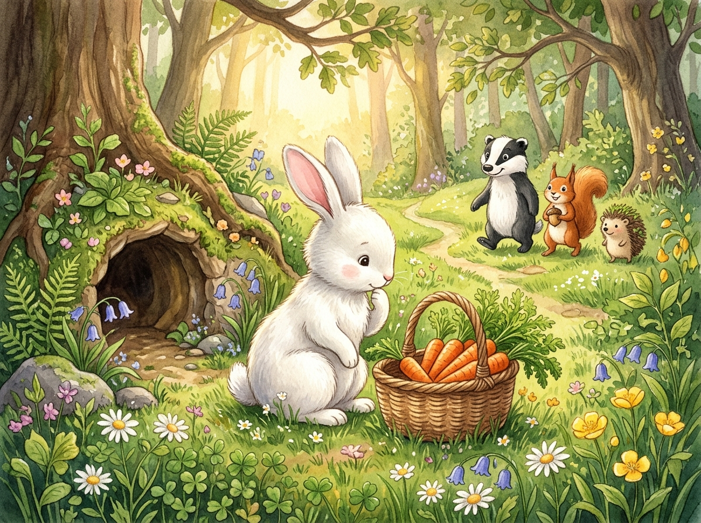

# ယုန်ဖြူလေးနှင့် အမြဲတမ်းတောင်းဆိုနေသော သူငယ်ချင်းများ

## ၁။ အစပျိုးခြင်း

တစ်ခါတုန်းက စိမ်းလန်းသာယာတဲ့ တောအုပ်ကြီးတစ်ခုမှာ ယုန်ဖြူလေးတစ်ကောင် နေထိုင်ခဲ့တယ်။ ယုန်ဖြူလေးဟာ စိတ်သဘောထားနူးညံ့ပြီး သူများကို ကူညီရတာ အလွန်နှစ်သက်သူလေးပါ။

သူငယ်ချင်းတစ်ယောက် အကူအညီလိုတိုင်း ယုန်ဖြူလေးက အမြဲတမ်း ကူညီပေးတတ်တယ်။

တစ်နေ့မှာ ရှဉ့်ကလေးက သူ့အတွက် အစာရှာပေးဖို့ တောင်းဆိုတယ်။

“ယုန်ဖြူလေးရေ၊ ငါ ဒီနေ့ အလုပ်များနေလို့ သစ်စေ့လေးတွေ သွားရှာပေးပါလား။”

“ရပါတယ် သူငယ်ချင်း။ ငါ သွားရှာပေးမယ်။”

ယုန်ဖြူလေးက သူ့အစာရှာဖို့တောင် မေ့ပြီး ရှဉ့်ကလေးအတွက် သစ်စေ့တွေ ရှာပေးခဲ့တယ်။

## ၂။ ဖြစ်စဉ်ပျိုးခြင်း

နောက်တစ်နေ့မှာ မျောက်ကလေးက သူ့အတွက် ငှက်ပျောသီးတွေ သယ်ပေးဖို့ တောင်းဆိုပြန်တယ်။

“ယုန်ဖြူလေးရေ၊ ငါ့အတွက် ငှက်ပျောသီးတွေ သယ်ပေးပါလား။ ငါကတော့ သစ်ပင်ပေါ်မှာ အနားယူနေလိုက်မယ်။”

ယုန်ဖြူလေးက ပင်ပန်းနေပေမယ့် ငြင်းမထွက်ခဲ့ဘူး။

“ကောင်းပါပြီ။ ငါ သယ်ပေးပါ့မယ်။”

ဒီလိုနဲ့ တစ်နေ့ပြီးတစ်နေ့ သူငယ်ချင်းတွေက ယုန်ဖြူလေးကို အကူအညီတောင်းကြတယ်။ ယုန်ဖြူလေးကလည်း ဘယ်သူ့ကိုမှ မငြင်းခဲ့ဘူး။

တစ်ခါတလေ သူ့အတွက် အစာစားချိန်တောင် မရှိတော့ဘူး။ အနားယူဖို့လည်း အချိန်မရတော့ဘူး။

## ၃။ အလှည့်အပြောင်း

တစ်နေ့မှာတော့ ယုန်ဖြူလေးဟာ အလုပ်တွေ အများကြီးလုပ်ထားရလို့ အလွန်ပင်ပန်းနေခဲ့တယ်။ အဲဒီအချိန်မှာပဲ မျောက်ကလေး ရောက်လာပြန်တယ်။

“ယုန်ဖြူလေးရေ၊ ငါ့အတွက် သစ်သီးတွေ သွားခူးပေးပါဦး။”

ယုန်ဖြူလေးက ဒီတစ်ခါတော့ ခေါင်းလေးငုံ့ပြီး ပြောလိုက်တယ်။

“ဒီနေ့တော့ ငါ မကူညီနိုင်သေးဘူး သူငယ်ချင်း။ ငါလည်း ပင်ပန်းနေပြီ။ ကိုယ့်အတွက် အစာရှာဖို့နဲ့ အနားယူဖို့ လိုနေတယ်။”

မျောက်ကလေးက မျက်နှာမကောင်းဖြစ်သွားတယ်။

“ဟာ... မင်းက အရင်ကဆို အမြဲကူညီပေးတတ်တာပဲ။ အခုတော့ သူငယ်ချင်းကိုတောင် မကူညီတော့ဘူးလား။”

အဲဒီစကားကြောင့် ယုန်ဖြူလေး စိတ်မကောင်းဖြစ်သွားတယ်။ ဒါပေမဲ့ သူ့အနားမှာ ရှိနေတဲ့ လိပ်အိုကြီးက အရာအားလုံးကို ကြားနေခဲ့တယ်။

## ၄။ အဖြေထွက်ခြင်း

လိပ်အိုကြီးက ယုန်ဖြူလေးကို ခေါ်ပြီး နူးညံ့စွာ ပြောလိုက်တယ်။

“ယုန်ဖြူလေးရေ၊ သူများကို ကူညီတာဟာ ကောင်းတဲ့အကျင့်ပါ။ ဒါပေမဲ့ ကိုယ့်ကိုယ်ကိုယ် ထိခိုက်နစ်နာတဲ့အထိ အမြဲအလျှော့ပေးနေဖို့ မလိုဘူးကွဲ့။”

“ဒါဆို သူများကို ငြင်းလိုက်ရင် ကျွန်တော်က မကြင်နာတတ်တဲ့သူ ဖြစ်သွားမှာလား အဘိုးကြီး။”

လိပ်အိုကြီးက ပြုံးပြီး ပြန်ဖြေတယ်။

“မဟုတ်ပါဘူး။ ကြင်နာတတ်ခြင်းဆိုတာ ကိုယ့်ကိုယ်ကိုယ် မေ့ပစ်လိုက်ခြင်း မဟုတ်ဘူး။ တကယ်လိုအပ်တဲ့အချိန်မှာ ကူညီပေးတာက ကြင်နာမှုပါ။ ဒါပေမဲ့ သူများရဲ့ တာဝန်ကို ကိုယ်က အမြဲထမ်းပေးနေရင်တော့ အဲဒါဟာ ကူညီခြင်းမဟုတ်တော့ဘူး။”

နောက်တစ်နေ့မှာ ရှဉ့်ကလေးက ယုန်ဖြူလေးဆီ ရောက်လာပြန်တယ်။

## ၅။ နိဂုံး

“ငါ့အတွက် သစ်စေ့တွေ ရှာပေးပါဦး။”

ယုန်ဖြူလေးက ပြုံးပြီး ပြောလိုက်တယ်။

“ဒီနေ့တော့ မင်းကိုယ်တိုင် ရှာကြည့်ပါလား။ မင်းလည်း ရှာတတ်ပါတယ်။ မသိတာရှိရင် ငါ သင်ပေးမယ်။”

ရှဉ့်ကလေးက အစပိုင်းမှာ စိတ်မကျေနပ်ပေမယ့် နောက်ဆုံးတော့ ကိုယ်တိုင် သစ်စေ့ရှာဖို့ သင်ယူခဲ့တယ်။

မျောက်ကလေးလည်း သူ့အလုပ်ကိုယ်တိုင် လုပ်တတ်လာတယ်။ သူငယ်ချင်းတွေကလည်း ယုန်ဖြူလေးကို အမြဲတမ်း အားကိုးနေမယ့်အစား တစ်ယောက်နဲ့တစ်ယောက် အပြန်အလှန် ကူညီတတ်လာကြတယ်။

ယုန်ဖြူလေးလည်း သူများကို ကူညီရင်း ကိုယ့်အတွက် အချိန်ပေးတတ်လာခဲ့တယ်။ သူ့စိတ်ထဲမှာလည်း အရင်ကလို ပင်ပန်းဝန်ပိနေခြင်း မရှိတော့ဘူး။

အဲဒီအချိန်ကစပြီး တောအုပ်ထဲက သူငယ်ချင်းတွေဟာ ကြင်နာမှုဆိုတာ တစ်ယောက်တည်း အမြဲပေးနေရတဲ့အရာ မဟုတ်ဘဲ အပြန်အလှန် မျှဝေကြရတဲ့အရာဖြစ်ကြောင်း နားလည်သွားကြတယ်။

---

## သင်ခန်းစာ

သူတစ်ပါးကို ကြင်နာကူညီခြင်းသည် မွန်မြတ်သော်လည်း မိမိကိုယ်ကို ထိခိုက်နစ်နာသည်အထိ အဆုံးမဲ့ လိုက်လျောမနေဘဲ မှန်ကန်သော နယ်နိမိတ်ကို သတ္တိရှိရှိ သတ်မှတ်တတ်ရမည်။
