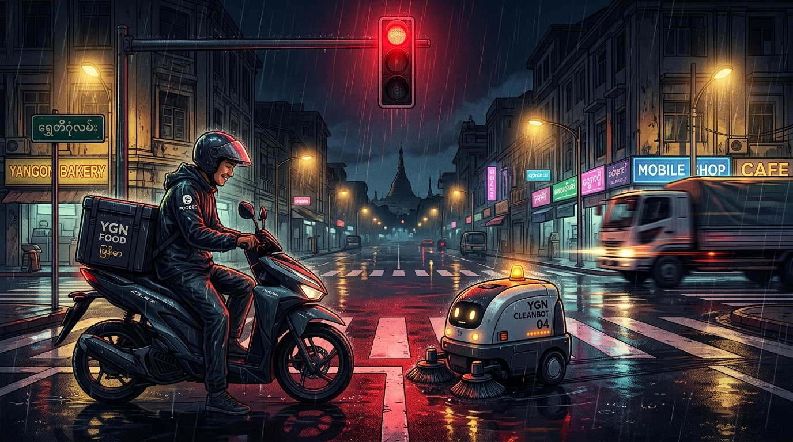

# ညသန်းခေါင် မီးပွိုင့်နှင့် စက်ရုပ်ငယ်

## ၁။ အစပျိုးခြင်း

မိုးဖွဲဖွဲ သဲသဲမဲမဲ ကျနေတဲ့ ညသန်းခေါင်မှာ ရန်ကုန်မြို့လယ် လမ်းမကြီးတွေ တိတ်ဆိတ်ရှင်းလင်းနေပြီ။ လမ်းမီးတိုင်ဝါဝါတွေက စိုရွှဲနေတဲ့ ကတ္တရာလမ်းပေါ် အရိပ်ထင်ပြီး တလက်လက် လင်းနေသတဲ့။

အမြန်ချောပို့သမား လူငယ်လေး ဖိုးသက်ဟာ နောက်ဆုံးကျန်တဲ့ အရေးပေါ် ဆေးပါဆယ်ထုပ် ပို့ဖို့ ဆိုင်ကယ်ကို ခပ်မြန်မြန် မောင်းလာတယ်။ တစ်ကိုယ်လုံး မိုးစိုပြီး ချမ်းတုန်မောပန်းနေတော့ အိမ်မြန်မြန်ပြန်နားချင်တဲ့ စိတ်ကသာ လောနေတာပေါ့။

## ၂။ ဖြစ်စဉ်ပျိုးခြင်း

လေးခွဆုံ မီးပွိုင့်နား ရောက်တော့ မီးနီသွားပါရော။ ဖိုးသက်လည်း ဆိုင်ကယ်အရှိန် လျှော့ရင်း ဘယ်ညာ ဝေ့ကြည့်လိုက်တယ်။

လမ်းပေါ်မှာ ဘယ်ကား ဘယ်ဆိုင်ကယ်မှ မရှိသလို စောင့်ကြည့်မယ့်သူ တစ်ယောက်မှ မတွေ့ဘူး။ မီးနီကလည်း စက္ကန့် လေးဆယ်လောက် စောင့်ရဦးမှာကိုး။

"လမ်းက ရှင်းနေတာပဲ၊ဘယ်သူမှလည်း မမြင်ဘူး။ ဖြတ်မောင်းလိုက်ရင် ဆယ်မိနစ်လောက် စောရောက်မှာပေါ့" လို့ တွေးပြီး ဖိုးသက် လီဗာဆွဲဖို့ ပြင်လိုက်တယ်။

အဲဒီအခိုက် ပလက်ဖောင်းဘေး လူကူးမျဉ်းကြားနားမှာ အဝါရောင်မီးလေး တဖျတ်ဖျတ် လင်းနေတဲ့ စည်ပင်သန့်ရှင်းရေး စက်ရုပ်ငယ်လေး "ဗီဇာ-၇" ကို လှမ်းမြင်သွားသတဲ့။

## ၃။ အလှည့်အပြောင်း

စက်ရုပ်ငယ် ဗီဇာ-၇ ဟာ မိုးစိုသစ်ရွက်တွေကို စက်လက်တံလေးတွေနဲ့ တဖျစ်ဖျစ် လှည်းကျင်းရင်း မျဉ်းကြားအစွန်းနား ရောက်လာတယ်။ တစ်ဖက်လမ်း ကူးမလို့ ဖြစ်ပေမဲ့ လူကူးမီးနီနေတာ မြင်တော့ ဘီးလေးတွေ တုံ့ခနဲ ရပ်ပြီး မီးစိမ်းမယ့်အချိန်ကို ငြိမ်ငြိမ် စောင့်နေတော့တာပဲ။

လူသူကင်းမဲ့နေတဲ့ ညသန်းခေါင်မှာ သံစက်ရုပ်လေးတစ်ခုက စည်းကမ်းကို မပျက်မကွက် လိုက်နာနေတာ မြင်တော့ ဖိုးသက် ရင်ထဲ ဒိန်းခနဲ ဖြစ်သွားလေရဲ့။

"စက်ရုပ်လေးတောင် ဘယ်သူမှ မရှိဘဲ စည်းကမ်း လိုက်နာနေသေးတာပဲ။ ငါက လူဖြစ်ပြီး စက္ကန့်ပိုင်းလေးအတွက် စည်းကမ်းဖောက်ရမှာလား"

ဖိုးသက်လည်း လီဗာဆွဲမယ့် လက်ကို လျှော့ပြီး ဘရိတ်အုပ်ကာ မီးစိမ်းတဲ့အထိ စောင့်နေလိုက်တယ်။

## ၄။ အဖြေထွက်ခြင်း

ဆိုင်ကယ် ရပ်စောင့်နေပြီး ဆယ်စက္ကန့်လောက် အကြာမှာပဲ ညာဘက်လမ်းကွေ့ကနေ ဝေါခနဲ အသံကြီး ထွက်လာပါလေရော။

ဘရိတ်ပေါက်လာတဲ့ တွဲကားကြီးတစ်စီးဟာ ဟွန်းသံ အဆက်မပြတ် တီးပြီး လမ်းဆုံအလယ်ကို အရှိန်ပြင်းပြင်းနဲ့ ဖြတ်ပြေးသွားတော့တာပဲ။ လေပြင်းဝှေ့ချက်ကြောင့် ဖိုးသက်ရဲ့ ဆိုင်ကယ်တောင် ဘေးကို ယိမ်းသွားရရှာတယ်။

စောစောကသာ မီးနီ ဖြတ်မောင်းခဲ့မိရင် အဲဒီတွဲကားကြီးအောက် ဝင်ပြီး အသက်တောင် ကျန်မှာ မဟုတ်ဘူးလေ။

## ၅။ နိဂုံး

ခဏနေတော့ မီးပွိုင့် အစိမ်းရောင် ပြောင်းသွားတယ်။ ဗီဇာ-၇ လေးဟာ မျဉ်းကြားအတိုင်း ဘီးလေးတွေ တလိမ့်လိမ့် လှိမ့်ပြီး တစ်ဖက်လမ်း ကူးကာ သူ့အလုပ် သူ ဆက်လုပ်နေလေရဲ့။

ဖိုးသက်ကတော့ ချမ်းတုန်နေတဲ့ လက်တွေနဲ့ စက်ရုပ်ငယ်လေးကို ငေးကြည့်ရင်း ရင်ထဲက လှိုက်လှိုက်လှဲလှဲ ကျေးဇူးတင်သွားမိတော့တာပေါ့။

---

## သင်ခန်းစာ

ဘယ်သူမှ မမြင်တဲ့အချိန် ကိုယ်တိုင် စောင့်ထိန်းတဲ့ စည်းကမ်းဟာ မထင်မှတ်တဲ့ အန္တရာယ်ကနေ ကိုယ့်အသက်ကို ကာကွယ်ပေးတတ်တယ်။
