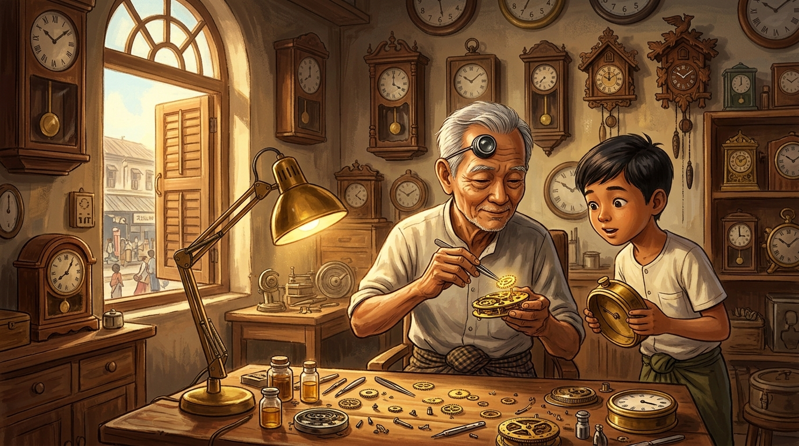

# နာရီပြင်ဆရာကြီး ဦးဘညွန့်နှင့် စက္ကန့်လက်တံ၏ လျှို့ဝှက်ချက်

## ၁။ အစပျိုးခြင်း

မီးရထားဘူတာဟောင်းကြီးရဲ့ မျက်နှာချင်းဆိုင်၊ သစ်သားပျဉ်ထောင် အိမ်စွန်ကလေးမှာ "ရတနာမွန် နာရီပြင်ဆိုင်" ဆိုတဲ့ ဆိုင်းဘုတ်ဟောင်းလေး ချိတ်ဆွဲထားသတဲ့။ ဆိုင်ကလေးထဲ ဝင်လိုက်တာနဲ့ နံရံအနှံ့ ချိတ်ဆွဲထားတဲ့ ရှေးဟောင်းသစ်သား နာရီကြီးတွေဆီက ချိန်သီးလွှဲသံ "တချက်ချက်... တချက်ချက်" နဲ့ ခပ်ငြိမ့်ငြိမ့် မြည်ဟီးနေတာပေါ့။ အဲဒီဆိုင်လေးထဲမှာ အသက် ခြောက်ဆယ်ကျော် နာရီပြင်ပညာရှင်ကြီး ဦးဘညွန့်ဟာ မျက်လုံးမှာ ချဲ့မှန်ဘီလူးကလေး ကပ်တပ်ရင်း မီးလုံးဝါဝါအောက်မှာ သေးငယ်လှတဲ့ သံမဏိသွားစိတ်လေးတွေကို ညင်သာစွာ ပြင်ဆင်နေတတ်လေရဲ့။

ဦးဘညွန့်ဆီမှာ အလုပ်သင်အဖြစ် ရောက်နေတဲ့ လူငယ်လေး ကိုစိုးနိုင်ကတော့ လက်ထဲက စမတ်ဖုန်းကို တတောက်တောက် နှိပ်လိုက်၊ နာရီအိမ်တွေကို ကပျာကယာ ကောက်ကိုင်လိုက်နဲ့ တစ်ချိန်လုံး ဂနာမငြိမ် ဖြစ်နေရှာတာပေါ့။ ကိုစိုးနိုင်ရဲ့ စိတ်ထဲမှာတော့ အချိန်ဆိုတာ အမြန်ဆုံး ဖြတ်သန်းရမယ့် အရာတစ်ခုလို သဘောထားပြီး ဘာမဆို ချက်ချင်းလက်ငင်း မြန်မြန်ပြီးမှ လူတော်လို့ ထင်နေတာပဲ။

## ၂။ ဖြစ်စဉ်ပျိုးခြင်း

တစ်နေ့တော့ ဘူတာရုံပိုင်ကြီး ဦးစံတင်ဟာ အလွန်တန်ဖိုးကြီးတဲ့ ရှေးဟောင်း ဂျာမနီလုပ် စားပွဲတင်နာရီကြီးတစ်လုံးကို ပိုက်ပြီး ဆိုင်ထဲ ကပြာကယာ ဝင်လာပါရော့လား။ နာရီကြီးက ညနေတိုင်း တေးသံသာသာ ပေးတတ်တဲ့ ချိန်သီးနာရီဖြစ်ပြီး အထဲက သွားစိတ်တစ်ခု ရပ်တန့်သွားလို့ မြည်သံမထွက်တော့တာတဲ့။

"ဆရာကြီး ဦးဘညွန့်ရေ... မနက်ဖြန် မနက် ရထားစထွက်ချိန် ဘူတာကြီးမှာ ဧည့်သည်တော်တွေ ကြိုဆိုပွဲ ရှိလို့ ဒီညနေအရောက် ကူပြင်ပေးပါဗျာ" လို့ အကူအညီ တောင်းရှာတယ်။

ဦးဘညွန့်က နာရီအဖုံးကို ဖွင့်၊ ချဲ့မှန်ဘီလူးနဲ့ သွားစိတ်အုံတစ်ခုချင်းစီကို "တဖျစ်ဖျစ်" အသံမထွက်အောင် ဂရုတစိုက် စစ်ဆေးနေတုန်း၊ အပြင်ကနေ ရပ်ကွက်လူကြီးတွေက အရေးပေါ်ကိစ္စနဲ့ လာခေါ်တာကြောင့် "စိုးနိုင်ရေ... နာရီကို ဒီအတိုင်းပဲ ထားဦး၊ ငါ ပြန်လာမှ အင်ဂျင်အုံကို ဖြုတ်ကြတာပေါ့" လို့ မှာကြားပြီး အပြင်ခေတ္တ ထွက်သွားလေရဲ့။

ဒါပေမဲ့ ကိုစိုးနိုင်ကတော့ ဆရာကြီး မရှိခိုက်မှာ သူ့လက်ရာကို ပြချင်တဲ့ စိတ်၊ မြန်မြန်ပြီးရင် ချီးကျူးခံရမယ်ဆိုတဲ့ အလောတကြီး မာနက ဝင်လာတော့တာပေါ့။ "ဒီလောက် သွားစိတ်လေးများ အချိန်ယူနေစရာ မလိုပါဘူး။ ဝက်အူလှည့်နဲ့ ကလစ်ခနဲ လှည့်ချလိုက်ရင် ပြီးတာပဲ" ဆိုပြီး ဆရာကြီး မှာထားတဲ့ စည်းကမ်းကို ကျော်လွန်ကာ နာရီစက်အုံကို အတင်းဆွဲဖြုတ်ပစ်လိုက်တာပဲ။

## ၃။ အလှည့်အပြောင်း

ကိုစိုးနိုင်ဟာ အလောတကြီးနဲ့ သံမဏိသွားစိတ်အုံတွေကို ဝက်အူလှည့်နဲ့ အတင်း ဖိလှည့်လိုက်တဲ့ ခဏမှာပဲ "ဂျွတ်... ခလောက်ခနဲ" ဆိုတဲ့ ကြောက်စရာ အသံဆိုးကြီး ထွက်ပေါ်လာပါရော့လား။

နာရီရဲ့ အဓိက အသက်သွေးကြောဖြစ်တဲ့ စက္ကန့်လက်တံ သွားစိတ်ရိုးတံ သေးသေးသွယ်သွယ်လေးဟာ ဘေးကို ကောက်ကွေးပြီး အစိတ်စိတ်အမြွာမြွာ ကျိုးထွက်သွားတော့တာပေါ့။ စပရင်ကြိုးကြီးကလည်း "ဝေါခနဲ" ပြုတ်ထွက်လာပြီး အထဲက သွားစိတ်အငယ်စားလေးတွေ စားပွဲခုံပေါ်ကို ပြန့်ကျဲကျသွားလေရဲ့။

ကိုစိုးနိုင်ခမျာ မျက်လုံးအဝိုင်းသားနဲ့ ခြေလက်တွေ တဆတ်ဆတ် တုန်ခိုက်ပြီး နဖူးကနေ ချွေးစေးတွေ တစိုစို ကျလာရှာတယ်။

"ဒုက္ခပါပဲ... ငါ ဘာလုပ်မိတာလဲ။ သွားစိတ်တွေ ကျိုးကုန်ပြီ၊ စက္ကန့်လက်တံလည်း လည်တော့မှာ မဟုတ်ဘူး" လို့ ညည်းတွားရင်း ပျာယာခတ်ကာ အပိုင်းအစတွေကို အတင်း ပြန်ဖိတပ်ပေမဲ့ ဘယ်လိုမှ တပ်လို့ မရတော့တာပဲ။

အဲဒီအချိန်မှာပဲ ဆိုင်တံခါး ပွင့်သွားပြီး ဦးဘညွန့် ပြန်ရောက်လာသတဲ့။ စားပွဲပေါ်က ပြန့်ကျဲနေတဲ့ သံမဏိသွားစိတ်ကျိုးတွေနဲ့ တုန်လှုပ်နေတဲ့ ကိုစိုးနိုင်ကို မြင်လိုက်ရတော့တာပေါ့။

## ၄။ အဖြေထွက်ခြင်း

ဦးဘညွန့်ဟာ ဒေါသတကြီး အော်ဟစ်ဆူပူမယ့်အစား သက်ပြင်းရှည်ကြီးတစ်ချက်ကို ညင်သာစွာ ချလိုက်ရှာတယ်။ ပြီးတော့ ထိုင်ခုံမှာ အေးဆေးစွာ ဝင်ထိုင်ရင်း ကွေးညွတ်ကျိုးပဲ့နေတဲ့ သွားစိတ်လေးကို ညှပ်စုတ်အသေးစားလေးနဲ့ ကောက်မပြီး သေချာ ပြသတဲ့။

"စိုးနိုင်... မင်း အပေါ်ယံ မြန်ဆန်ချင်စိတ်တစ်ခုတည်းနဲ့ တွန်းလုပ်လိုက်တော့ စက္ကန့်လက်တံရဲ့ သဘောကို မေ့သွားတယ် မဟုတ်လား" လို့ မေးလေရဲ့။

ကိုစိုးနိုင်က ခေါင်းငိုက်စိုက်ကျရင်း "ကျနော်... မြန်မြန် ပြီးချင်လို့ပါ ဆရာကြီးရယ်။ အချိန်ကုန်တာ သိပ်မကြိုက်လို့ စိတ်လောသွားတာပါဗျာ" လို့ တုန်ရီစွာ ဝန်ခံရှာတယ်။

အဲဒီအခါ ဦးဘညွန့်က ခေါင်းတညိတ်ညိတ်နဲ့ သဘောထားကြီးစွာ ပြုံးပြရင်း—

"နာရီတစ်လုံးမှာ နာရီလက်တံကြီးက အရေးကြီးဆုံးလို့ လူတွေ ထင်ကြပေမဲ့ တကယ်တော့ တိတ်ဆိတ်စွာ စက္ကန့်မလပ် လှည့်ပတ်ပေးနေတဲ့ ဒီ စက္ကန့်လက်တံ သွားစိတ် သေးသေးလေးတွေက အဓိကပဲကွဲ့။ အဲဒီ သွားစိတ်ငယ်လေး တစ်ခုချင်းစီကို စိတ်ရှည်လက်ရှည် မညှိဘဲ အလျင်စလို အတင်းလှည့်လိုက်ရင် စနစ်တစ်ခုလုံး ပျက်စီးသွားတတ်တယ်။ လူ့ဘဝနဲ့ အလုပ်တွေလည်း ဒီလိုပါပဲ။ မြန်ဆန်တာထက် တိကျသေချာတဲ့ စူးစိုက်မှုကမှ တန်ဖိုးအစစ်အမှန်ကို ဆောင်ကျဉ်းပေးနိုင်တာ" လို့ ရှင်းပြလေရဲ့။

ဦးဘညွန့်ဟာ ပျက်စီးသွားတဲ့ သွားစိတ်အစား သံမဏိချောင်းငယ်လေးကို လက်မှုစက်ခုံပေါ်တင်ပြီး မျက်မှန်ဘီလူးတပ်ကာ တစ်စိတ်ချင်း၊ တစ်မျှင်ချင်း သွေးယူတော့တာပေါ့။ ကိုစိုးနိုင်လည်း ဖုန်းကို ဘေးချိတ်ပြီး ဆရာကြီးရဲ့ စိတ်ရှည်မှု၊ ငြိမ်သက်မှုနဲ့ တိကျတဲ့ လက်ချောင်းလှုပ်ရှားမှုတွေကို အနားကနေ မျက်တောင်မခတ်ဘဲ စူးစူးစိုက်စိုက် ကူညီလေ့လာတော့တာပဲ။

## ၅။ နိဂုံး

သန်းခေါင်ယံ အချိန်ရောက်တော့ ဦးဘညွန့်နဲ့ ကိုစိုးနိုင်တို့ နှစ်ယောက် စိတ်ရှည်လက်ရှည် ပြန်လည် တပ်ဆင်လိုက်တဲ့ ဂျာမနီနာရီကြီးဟာ နဂိုအတိုင်း ပြန်လည် အသက်ဝင်လာပါရော့လား။

"ဒေါင်... ဒေါင်... ဒေါင်..." ဆိုတဲ့ ကြည်လင်သာယာတဲ့ သံချောင်းခေါက်သံနဲ့အတူ စက္ကန့်လက်တံလေးဟာ ပျဉ်ထောင်နံရံအလယ်မှာ "တချက်ချက်... တချက်ချက်" နဲ့ ခိုင်မာမှန်ကန်စွာ စတင် လည်ပတ်သွားတော့တာပေါ့။

ကိုစိုးနိုင်ဟာ ပြတင်းပေါက်ကနေ ဖြတ်တိုက်လာတဲ့ ညလေအေးကို ရှူရှိုက်ရင်း စက္ကန့်လက်တံလေးရဲ့ မှန်ကန်ငြိမ့်ညောင်းတဲ့ ခြေလှမ်းတွေကို ပြုံးပြုံးလေး ငေးကြည့်နေမိလေရဲ့။ သူ့စိတ်ထဲမှာလည်း အလျင်စလို အာရုံပျံ့လွင့်မှုတွေ ပျောက်ကွယ်သွားပြီး စိတ်ရှည်စွာ အာရုံစူးစိုက်တတ်တဲ့ တန်ဖိုးကို နှလုံးသားထဲမှာ စွဲမြဲစွာ မှတ်ကျောက်တင်လိုက်တော့တာပဲ။

---

## သင်ခန်းစာ

အလျင်စလို အာရုံပျံ့လွင့်ခြင်းထက် စိတ်ရှည်စွာ အသေးစိတ် စူးစိုက်စစ်ဆေးခြင်းကသာ တိကျခိုင်မာသော တန်ဖိုးကို ဖြစ်ထွန်းစေသည်။ အပေါ်ယံ မြန်ဆန်မှုကို ဦးစားပေးပြီး အရေးကြီးသော အဆင့်ငယ်များကို လျစ်လျူရှုလိုက်ပါက အဖိုးတန်ဆုံး အရာများပင် ပျက်စီးဆုံးရှုံးသွားတတ်သည်။
