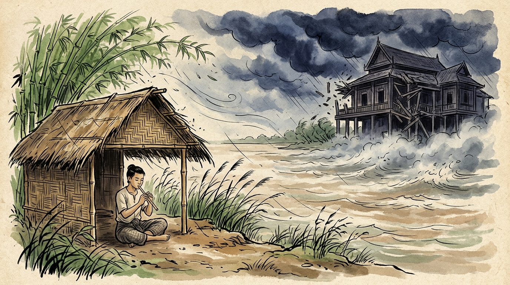

# မြစ်ကမ်းပါးက နှီးကြမ်းလေချွန်သံ

## ၁။ အစပျိုးခြင်း

ဧရာဝတီမြစ်ကြီး ကွေ့ဝိုက်စီးဆင်းသွားတဲ့ ရွာစွန်သဲသောင်ပြင်လေးမှာ နှီးထိုးလက်မှုဆရာ မောင်မင်းဒင် နေထိုင်ရှာတာပေါ့။ မောင်မင်းဒင်က ကမ်းပါးတစ်လျှောက် စိမ်းစိမ်းစိုစို ပေါက်နေတဲ့ ကျူပင်၊ ကိုင်းပင်လေးတွေနဲ့ နှီးဝါးခြမ်းတွေကို စိတ်ရှည်လက်ရှည် ဖြာချရင်း တောင်းပလုံးတွေ၊ သပ်ရပ်တဲ့ ဖျာချောတွေ ရက်လုပ်တတ်သတဲ့။ အားလပ်ချိန်ဆိုရင်လည်း ကျူရိုးခေါင်းပွလေးတွေကို ဓားထက်ထက်နဲ့ ညှိဖြတ်ပြီး လေတိုက်ရင် သာယာကြည်နူးဖွယ် တေးသံထွက်တဲ့ လေချွန်ပုလွေကလေးတွေ ဖန်တီးနေတတ်တာပဲ။

ဒါပေမဲ့ သူ့အိမ်နဲ့ မျက်နှာချင်းဆိုင်မှာတော့ ရွာထဲက အချမ်းသာဆုံး သစ်ကုန်သည်ကြီး ဦးငွေမှုံ နေတယ်လေ။ ဦးငွေမှုံကတော့ တောနက်ကြီးထဲက ခုတ်ထုတ်လာတဲ့ ကျွန်းသစ်၊ ပျဉ်းကတိုးလို အဖိုးတန် သစ်မာတုံးကြီးတွေကိုမှ မဟုတ်ရင် ဘာကိုမှ အထင်မကြီးရှာဘူး။ သူ့အိမ်ကြီးကိုလည်း "ဘယ်မုန်တိုင်းလာလာ မလှုပ်ဘူးဟေ့" လို့ ကြုံးဝါးပြီး၊ လုံးပတ်ထွားထွား သစ်မာတိုင်လုံးကြီးတွေနဲ့ မြေစိုက်ခံ့ခံ့ ကြီးကျယ်ခမ်းနားစွာ ဆောက်ထားတာပေါ့။

## ၂။ ဖြစ်စဉ်ပျိုးခြင်း

မနက်တိုင်း ဦးငွေမှုံဟာ မောင်မင်းဒင် နှီးထိုးနေတာကို မြင်ရင် လက်ဖျစ်တီးပြီး နှာခေါင်းရှုံ့လေ့ရှိတယ်။

"ဟေ့ကောင် မောင်မင်းဒင်... မင်းရဲ့ နှီးကြမ်းတွေ၊ ကျူရိုးခေါင်းပွတွေဆိုတာ လေတိုက်ရင် ယိမ်းထိုးနေတဲ့ ပျော့စိစိအရာတွေပဲကွ။ ငါ့အိမ်က သစ်မာတိုင်လုံးကြီးတွေကို ကြည့်စမ်း၊ အဆူးမထွင်း၊ ပုဆိန်နဲ့ ပေါက်တောင် ပြန်ကန်ထွက်လောက်အောင် မာတောင့်တောင့် ခိုင်တာဟေ့။ လောကမှာ မာမာကျောကျော တောင့်ခံနိုင်မှ လူရာဝင်တာကွ" လို့ အမြဲ မာန်မဲဝါကြွားတော့တာပဲ။

မောင်မင်းဒင်ကတော့ ဒေါသလည်း မထွက်၊ ပြိုင်လည်း မငြင်းဘဲ လက်ထဲက နှီးစလေးကို အသာအယာ ကျစ်ရင်း—

"မိုးကြိုးပစ်ရင် သစ်မာပင်ကြီးတွေပဲ အမြစ်က ကျွတ်ကျတာ ဦးလေးရ။ ကျူရိုးလေးတွေကတော့ လေပြင်းလာရင် ဝပ်၊ လေငြိမ်ရင် ပြန်ထောင်ပဲ။ မာလွန်းရင် ကျိုးလွယ်တယ်ဆိုတာ အဲဒါပေါ့" လို့သာ သဘောထားကြီးကြီး ပြန်ပြောတတ်ရှာတယ်။

အဲဒီနှစ် မိုးနှောင်းဆောင်းဦးကာလကို ရောက်တော့ မြစ်မကြီးတစ်လျှောက် နှစ်ပေါင်းများစွာ မကြုံစဖူးတဲ့ မိုးသက်လေပြင်းမုန်တိုင်းကြီး ဝင်ရောက်တိုက်ခတ်တော့မယ်ဆိုတဲ့ သတင်းတွေ ရွာထဲ ပျံ့နှံ့လာရော့သလား။

## ၃။ အလှည့်အပြောင်း

သန်းခေါင်ယံ အချိန်ရောက်တော့ ကောင်းကင်တစ်ခုလုံး မင်ရည်သုတ်ထားသလို မည်းမှောင်ကျလာပြီး လေရိုင်းကြီးက ဝေါခနဲ ဂျိန်းခနဲ သစ်တောတစ်ခုလုံးကို လှုပ်ခါပစ်တော့တာပဲ။ မိုးသီးမိုးပေါက်တွေက သဲသဲမဲမဲ ကျဆင်းလာပြီး လေပြင်းက သစ်ပင်ကြီးတွေကို အမြစ်က ဆွဲနှုတ်တော့မယ့်အတိုင်း တဝေါဝေါနဲ့ ကြောက်ခမန်းလိလိ ဟိန်းဟောက်နေတော့တယ်။

ဦးငွေမှုံကတော့ သူ့ရဲ့ သစ်မာတိုက်ကြီးကို အထင်ကြီးလွန်းတော့ တံခါးရွက်အားလုံးကို သံမဏိချိတ်တွေနဲ့ တင်းတင်းကျပ်ကျပ် ပိတ်ဆို့ပြီး မုန်တိုင်းကို အလျှော့မပေးဘဲ အံတုတောင့်ခံထားတာပေါ့။ ဒါပေမဲ့ လေဖိအားက ပြင်းထန်လာလေလေ၊ လေဒဏ်ကို လုံးဝညွတ်မပေးနိုင်တဲ့ ကျွန်းတိုင်လုံးကြီးတွေဆီက "တဂျွတ်ဂျွတ်... တကျွိကျွိ" နဲ့ မခံမရပ်နိုင် အက်ကွဲသံတွေ ထွက်လာလေလေပဲ။ အလျှော့မပေးဘဲ မာကျောလွန်းနေတော့ မုန်တိုင်းရဲ့ တွန်းအားဒဏ်အားလုံးကို တည့်တည့်ခံရပြီး သစ်မာတိုင်ကြီးတွေ တဖြည်းဖြည်း ယိုင်နဲ့ဒူးထောက်လာရရှာတယ်။

## ၄။ အဖြေထွက်ခြင်း

ဟိုဘက်ကမ်းက မောင်မင်းဒင်ရဲ့ နှီးတဲငယ်လေးကတော့ လေတိုက်ရာဘက်ကို လိုက်လျောညီထွေ ဘယ်ယိမ်းညာနွဲ့နဲ့ ကပြနေသလိုပဲ။ လေပြင်းစီးကြောင်းကို အတင်းအဓမ္မ မတားဆီးဘဲ နှီးကွယ်လေးတွေကို အလိုက်သင့် ဟပေးထားတော့ လေဟာ တဲလေးကို တိုးဝှေ့ဖြတ်သန်းသွားရုံကလွဲလို့ ဘာအန္တရာယ်မှ မပေးနိုင်ရှာဘူး။ မြစ်ကမ်းပါးက ကျူပင်ရုံလေးတွေဆိုရင်လည်း မြေပြင်ထိအောင် ခေါင်းလေးတွေငုံ့ပြီး မုန်တိုင်းအရှိန်ကို ညွတ်ပျောင်းစွာ လျှောချပေးနေကြတာပေါ့။

အဲဒီအချိန်မှာပဲ ဦးငွေမှုံရဲ့ အိမ်ကြီးဆီက "ဂျိန်း... ဝုန်း" ဆိုတဲ့ ကျယ်လောင်လှတဲ့ ပြိုကျသံကြီး ထွက်ပေါ်လာလေရဲ့။ မာလွန်းလှပါတယ်ဆိုတဲ့ သစ်မာတိုင်လုံးကြီးတွေဟာ အလယ်ကနေ ဒရဟတ် ကျိုးပြတ်ပြီး သစ်တိုက်ကြီးတစ်ခုလုံး မြေပြင်ပေါ် အပိုင်းပိုင်း ပြိုကျသွားတော့တာပဲ။ အပျက်အစီးတွေအောက်မှာ ပိတ်မိနေတဲ့ ဦးငွေမှုံကို မောင်မင်းဒင်က မုန်တိုင်းကြားကနေ ခြေကုန်သုတ် ပြေးလွှားကယ်ထုတ်ပြီး သူ့ရဲ့ လုံခြုံတဲ့ နှီးတဲလေးဆီ ကုန်းပိုးခေါ်ဆောင်လာခဲ့ရရှာတယ်။

## ၅။ နိဂုံး

မိုးသောက်အလင်းရောက်လို့ မုန်တိုင်းစဲသွားချိန်မှာတော့ ရွာလမ်းတစ်လျှောက်မှာ မာမာတောင့်တောင့် သစ်ကိုင်းကြီးတွေ၊ သစ်ပင်ကြီးတွေ မြေပေါ်မှာ ကျိုးပြတ်လဲကျနေတာကို တွေ့ရတော့တာပဲ။ ဒါပေမဲ့ မြစ်ကမ်းပါးက ကျူပင်ရုံလေးတွေနဲ့ ဝါးတဲငယ်လေးကတော့ နံနက်ခင်း နေခြည်နုနုအောက်မှာ စိမ်းလန်းလန်း မတ်မတ်ကလေး ပြန်ထရပ်နေကြပြီး၊ လေနုအဝှေ့မှာ ကျူရိုးခေါင်းပွလေးတွေဆီက တေးသံသာသဖွယ် သာယာကြည်နူးဖွယ် လေချွန်သံလေးတွေ ထွက်ပေါ်နေလေရဲ့။

ဦးငွေမှုံခမျာ ပြိုကျပျက်စီးသွားတဲ့ သစ်တိုက်ကြီးကို ငေးကြည့်ရင်း မျက်ရည်တွေ ဝဲတက်လာရှာတယ်။ မာလွန်းရင် ကျိုးလွယ်ပြီး၊ အခြေအနေနဲ့ လိုက်လျောညီထွေ ညွတ်ပျောင်းပေးတတ်မှသာ ဘဝရဲ့ ဘယ်မုန်တိုင်းကိုမဆို မကျိုးမပျက် ကျော်လွှားနိုင်တယ်ဆိုတဲ့ အသိဟာ သူ့ရင်ထဲ စွဲမြဲသွားတော့တာပေါ့။

---

## သင်ခန်းစာ

ပြင်းထန်သော လောကဓံမုန်တိုင်းနှင့် ရင်ဆိုင်ရချိန်တွင် မာကျောတောင့်တင်းလွန်းခြင်းထက် အခြေအနေနှင့်အညီ ညွတ်ပျောင်းလိုက်လျောတတ်ခြင်းကသာ မကျိုးမပျက်ဘဲ ရေရှည်ရှင်သန်စေနိုင်သည်။
