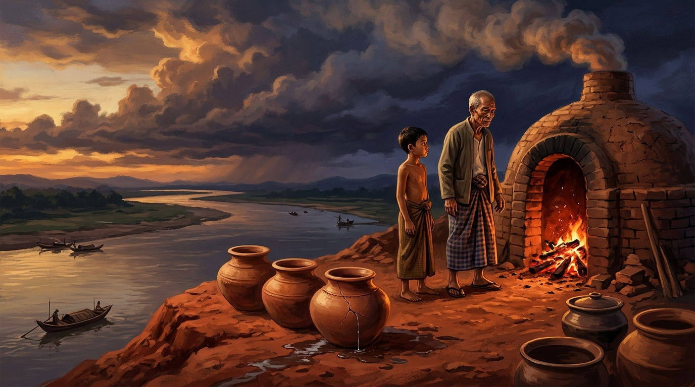

# အိုးထိန်းသည် ဦးဘိုးလွင်နှင့် မီးခိုးငွေ့ကြားက အက်ကြောင်း

## ၁။ အစပျိုးခြင်း

ချင်းတွင်းမြစ်ရိုး မြေနီကုန်းမြင့်ပေါ်မှာ အိုးထိန်းသည်ကြီး ဦးဘိုးလွင်ရဲ့ အိုးဖုတ်ဖိုဟောင်းကြီး ရှိတယ်။ ဦးဘိုးလွင်က လက်ရာသွက်တဲ့ နာမည်ကြီး ဆရာတစ်ဦးမို့ လက်လှည့်ဘီးပေါ်မှာ ရွှံ့စေးပျော့စိစိအလိပ်ကို တဖျစ်ဖျစ် တလှုပ်လှုပ် နယ်ဖတ်ပြီး မျက်စိတစ်မှိတ်အတွင်း ဟင်းချက်အိုး၊သောက်ရေအိုးတွေ အများကြီး ပုံဖော်နိုင်သတဲ့။ ဒါပေမဲ့ သူ့မှာ အလုပ်ကို မြန်မြန်ပြီးချင်တဲ့ လောဘနဲ့ အရေအတွက်များရင် ပြီးရောဆိုတဲ့ မာနကလေး ရှိနေရှာတာပေါ့။

တပည့်လူငယ် မောင်သာဒင်ကျတော့ ဆရာနဲ့ မတူဘူး။ မောင်သာဒင်က ရွှံ့မြေကို သဲစင်အောင် စိတ်ရှည်ရှည် ဆန်ခါတိုက်ပြီး ပုံသွင်းပြီးရင်လည်း သစ်ပင်ရိပ်အောက်မှာ လေနဲ့ ဖြည်းဖြည်းချင်း အခြောက်ခံရမှ စိတ်ချတတ်သူလေ။

## ၂။ ဖြစ်စဉ်ပျိုးခြင်း

မိုးဦးမကျမီ ကုန်လှေကြီး ထွက်ခါနီး သုံးရက်အလိုမှာ မြို့ပေါ်က အိုးကုန်သည်ကြီးတစ်ဦး ကမန်းကတန်း ရောက်လာပါရော။

"ဆရာကြီး ဦးဘိုးလွင်ရေ... မြို့တော်ဝန်အိမ်မှာ ပွဲကြီးရှိလို့ ရေမယိုတဲ့ သောက်ရေအိုး ချောချော ငါးဆယ် အမြန်လိုချင်တယ်ဗျာ။ သုံးရက်အတွင်း ပြီးရင် ပုံမှန်ထက် နှစ်ဆပေးမယ်" ဆိုပြီး ငွေစရံထုပ်ကြီးကို ဝါးကြမ်းပြင်ပေါ် "ဒုတ်" ခနဲ ချပေးသွားတယ်။

ဦးဘိုးလွင် မျက်လုံးအရောင်လက်သွားပြီး "စိတ်ချပါ ကုန်သည်ကြီးရယ်... သုံးရက်မပြောနဲ့၊မနက်ဖြန်ညနေ အပြီးဖုတ်ပြမယ်" လို့ ကြုံးဝါးလိုက်တာပေါ့။

ကုန်သည် ပြန်သွားတာနဲ့ ဦးဘိုးလွင်ဟာ ပုံသွင်းပြီးစ စိုထိုင်းထိုင်း အိုးငါးဆယ်စလုံးကို နေပူပြင်းပြင်းထဲ ဆွဲထုတ်လှန်းဖို့ ပြင်တော့တာပဲ။ မောင်သာဒင်က နှာခေါင်းရှုံ့ပြီး ဝင်တားရှာတယ်။

"ဆရာ... အိုးတွေက အစိုဓာတ် မကုန်သေးဘူးဗျ။ အတွင်းသား ပျော့စိစိ ရှိတုန်း နေပူထဲ အတင်းလှန်းပြီး မီးပြင်းတိုက်ရင် အတွင်းက အက်ကွဲကုန်မယ် ဆရာရယ်"

ဦးဘိုးလွင်က လက်ခါပြပြီး— "မင်းက ကလေးမို့ ဘာသိလဲ။ အချိန်ဆွဲနေရင် ငွေလွတ်ကုန်မှာပေါ့ကွ။ မီးပြင်းပြင်း တိုက်လိုက်ရင် ခဏချင်း မာတောင့်တောင့် ဖြစ်သွားတာပဲ" လို့ မာန်မဲကာ အိုးစိုတွေကို နေပူထဲ ထုတ်ပစ်လိုက်သတဲ့။

## ၃။ အလှည့်အပြောင်း

နောက်တစ်နေ့ ညနေစောင်းတော့ မိုးတိမ်တွေ မည်းမှောင်လာပြီး လေရိုင်းတွေ တဝေါဝေါ စတိုက်လာတယ်။ မိုးမကျခင် ပြီးရမယ်ဆိုတဲ့ ဇောနဲ့ ဦးဘိုးလွင်ဟာ အပေါ်ယံပဲ ခြောက်သေးတဲ့ အိုးငါးဆယ်ကို ဖိုကြီးထဲ အတင်း ထိုးထည့်ပစ်လိုက်လေရဲ့။

ထင်းခြောက်၊ဝါးဆစ်ခြောက်တွေ ထိုးထည့်ပြီး မီးကို တဟုန်းဟုန်း တိုက်တော့ မီးလျှံတွေ တရှဲရှဲ တဖြန်းဖြန်း ထွက်လာတယ်။

"ဆရာ... မီးလျှော့ပါဦး။ အပူမြန်လွန်းရင် အိုးသား အငွေ့မထွက်နိုင်ဘဲ ကွဲကုန်လိမ့်မယ်" လို့ မောင်သာဒင်က တောင်းပန်ရှာတယ်။

ဦးဘိုးလွင်က နားမထောင်ဘဲ "မြန်မြန်ဖုတ်မှ မြန်မြန်ကျက်တာပေါ့ဟေ့" ဆိုပြီး ထင်းတွေ ဒရဟတ် ထပ်ထိုးထည့်တယ်။ ဖိုထဲက "တဂျွတ်ဂျွတ်... တဖျစ်ဖျစ်" နဲ့ သဲ့သဲ့မြည်သံ ထွက်လာပေမဲ့ အိုးသားကျစ်သွားတဲ့အသံ ထင်ပြီး ပြုံးနေရှာတာပေါ့။

## ၄။ အဖြေထွက်ခြင်း

သန်းခေါင်ကျော် မိုးစဲချိန် ဖိုအေးသွားလို့ အိုးတွေ ထုတ်ကြည့်ကြတယ်။ အပြင်ပန်း ကြည့်ရင်တော့ အိုးငါးဆယ်စလုံး အနီရောင် ပြောင်လက်ပြီး ခန့်ညားနေတာပဲ။

ဦးဘိုးလွင်က ဟက်ဟက်ပက်ပက် ရယ်ပြီး "တွေ့လား မောင်သာဒင်... မင်းစကား နားထောင်နေရင် အခုလို ပြီးပါ့မလား" လို့ ဝါကြွားသတဲ့။

မောင်သာဒင်က ဘာမှမပြောဘဲ ရေပုံးတစ်ပုံး ခပ်ယူလာပြီး ရှေ့ဆုံးအိုးထဲ ရေအေးလေး အသာ လောင်းထည့်ကြည့်လိုက်တယ်။

အဲဒီခဏမှာပဲ "တရှဲရှဲ... ဖျစ်ခနဲ" မြည်ပြီး အိုးအောက်ခြေက ဆံခြည်မျှင်လောက် အက်ကြောင်းလေးတွေ ပေါ်လာကာ ရေတွေ တစိမ့်စိမ့် ယိုကျသွားပါရော။ ဦးဘိုးလွင် မျက်လုံးပြူးပြီး ကျန်တဲ့အိုးတွေ ရေထည့်စမ်းကြည့်တော့ တစ်လုံးမှ ရေမခံနိုင်တော့တာ တွေ့လိုက်ရရှာတယ်။

## ၅။ နိဂုံး

မနက်ခင်း ကုန်သည်ကြီး ရောက်လာတော့ အိုးတွေ ရေယိုနေတာ မြင်ပြီး စရံငွေ ပြန်သိမ်းကာ လှေလှည့်ထွက်သွားတယ်။

ဖိုဟောင်းကြီးဘေး အိုးကွဲစတွေ ငေးကြည့်ရင်း ဦးဘိုးလွင် ငုတ်တုတ်ထိုင် သက်ပြင်းချရှာတယ်။ "ငါ့လောဘနဲ့ မာနကြောင့် အလုပ်ပျက်ကုန်တာပဲ။ အဆင့်ကျော်ပြီး အမြန်လုပ်တဲ့ အလုပ်ဟာ အပေါ်ယံပဲ လှပြီး အတွင်းက အက်ကွဲတတ်ပါရော့လား" လို့ ဝန်ခံရှာတာပေါ့။

အဲဒီနောက် ဦးဘိုးလွင်ဟာ မောင်သာဒင်နဲ့အတူ ရွှံ့စေးကို သေချာနယ်၊အရိပ်ထဲ ဖြည်းဖြည်း အခြောက်ခံပြီးမှ မီးအေးအေးနဲ့ ပြန်ဖုတ်ကြတော့တယ်။ စိတ်ရှည်ရှည် ဖုတ်ထားတဲ့ အိုးသစ်တွေကတော့ ရေတစ်စက်မှ မယိုဘဲ တစ်နယ်လုံးမှာ နာမည်ပြန်ရသွားတော့သတဲ့။

---

## သင်ခန်းစာ

အလျင်လိုပြီး အဆင့်ကျော်လုပ်တဲ့ အလုပ်ဟာ အပြင်ပန်း ဘယ်လောက်လှလှ အတွင်းသားမှာ အက်ကြောင်း ကျန်တတ်တယ်။ ကောင်းကောင်းပြီးချင်ရင် တစ်ဆင့်ချင်း စိတ်ရှည်ရှည် လုပ်ရတာပေါ့။
