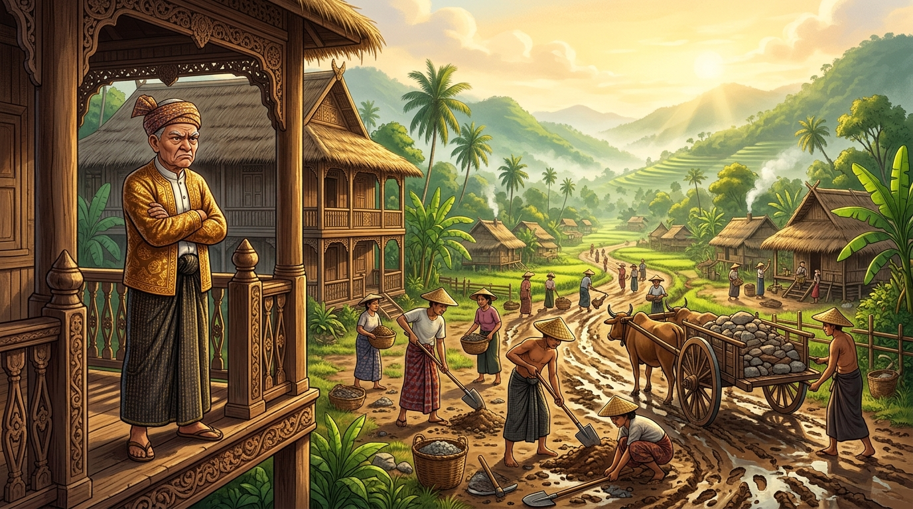

# သူဌေးကြီး နှင့် လမ်းကလေး

## ၁။ အစပျိုးခြင်း

မြန်မာနိုင်ငံရဲ့ ဝေးလံခေါင်ဖျားတဲ့ တောင်ကြားရွာလေးတစ်ရွာမှာ “သာယာကုန်း” လို့ခေါ်တဲ့ ရွာလေးတစ်ရွာ ရှိတယ်။
ရွာလေးဟာ သစ်ပင်ကြီးတွေကြားထဲမှာ တိတ်တိတ်ဆိတ်ဆိတ် နေရာယူထားပြီး မိုးရာသီရောက်တိုင်း လမ်းတွေက ရွှံ့ဗွက်အပြည့် ဖြစ်သွားတတ်တယ်။

လူသွားလူလာ နည်းသလို မြို့ကိုသွားတဲ့ လမ်းကလည်း ကျောက်ခဲတွေထူထပ်ပြီး ချိုင့်ခွက်တွေနဲ့ ပြည့်နေတယ်။
လှည်းတောင် ခက်ခက်ခဲခဲ သွားရတဲ့လမ်းမို့ ရွာသားတွေက အမြဲစိတ်ညစ်နေကြတယ်။

အဲ့ဒီရွာမှာ “ဦးဘိုးသန်း” ဆိုတဲ့ သူဌေးကြီးတစ်ယောက် ရှိတယ်။
သူ့မှာ လယ်တွေ၊ နွားတွေ၊ ဆန်ဂိုဒေါင်တွေ အများကြီးရှိပေမယ့် အရမ်းတွန့်တိုတတ်သူ ဖြစ်တယ်။

ရွာသားတွေကတော့
“ဦးဘိုးသန်းက ပိုက်ဆံရှိပေမယ့် ကပ်စီးကုတ်ကြီး”
လို့ တိုးတိုးတိတ်တိတ် ပြောကြတယ်။

ဒါ့အပြင် ဦးဘိုးသန်းဟာ နှလုံးရောဂါကိုလည်း ခံစားနေရသူ ဖြစ်တယ်။
တခါတလေ ရင်ဘတ်ကို ဖိကိုင်ပြီး
“အင်း… အသက်ကြီးလာတော့ မလွယ်တော့ဘူး…”
လို့ ညည်းတတ်တယ်။

တစ်နေ့မှာတော့ ရွာသူရွာသားတွေ စုပေါင်းပြီး မြို့သွားလမ်းကို ပြုပြင်ဖို့ ဆုံးဖြတ်လိုက်ကြတယ်။
အိမ်တိုင်းကို လိုက်ပြီး အလှူငွေ စုကြတယ်။

## ၂။ ဖြစ်စဉ်ပျိုးခြင်း

နောက်ဆုံးမှာတော့ ဦးဘိုးသန်းအိမ်ကို ရောက်လာကြတယ်။

“သူဌေးကြီးရေ… ရွာလမ်းလေး ပြင်ဖို့ အလှူထည့်ပါဦး”
လို့ ရွာလူကြီးက ယဉ်ယဉ်ကျေးကျေး ပြောလိုက်တယ်။

ဦးဘိုးသန်းက မျက်နှာကို ချက်ချင်းမဲ့သွားပြီး

“လမ်းကောင်းတော့ ငါဘာအကျိုးရှိမှာလဲ။
ငါက အိမ်မှာပဲနေတဲ့သူ။ မထည့်နိုင်ဘူး”
လို့ ခပ်ပြတ်ပြတ် ပြောလိုက်တယ်။

ရွာသားတွေက စိတ်မကောင်းဖြစ်ပေမယ့် ဘာမှမပြောဘဲ ပြန်သွားကြတယ်။

ရက်အနည်းငယ်ကြာပြီး တစ်ညမှာတော့ မိုးတွေရွာနေတယ်။
လေကလည်း တဝူးဝူး တိုက်နေတယ်။

အဲ့ဒီညမှာပဲ ဦးဘိုးသန်းဟာ ရင်ဘတ်ကို ဖိကိုင်ပြီး ကြမ်းပေါ်လဲကျသွားတယ်။

## ၃။ အလှည့်အပြောင်း

“အား… ငါ့ရင်… ငါ့ရင်…!”

မိသားစုတွေက ထိတ်လန့်သွားပြီး မြို့ဆေးရုံကို အမြန်ပို့ဖို့ လှည်းပြင်ကြတယ်။

ဒါပေမယ့် လမ်းက ရွှံ့ဗွက်တွေ၊ ချိုင့်ခွက်တွေကြောင့် လှည်းက တုန်ခါလွန်းတယ်။
နွားတွေတောင် ခက်ခက်ခဲခဲ ဆွဲနေရတယ်။

ဦးဘိုးသန်းက လှည်းပေါ်မှာ နာကျင်ဝေဒနာကို သေလုမြောပါး ခံစားနေရတယ်။

လှည်းတစ်ချက်ခုန်တိုင်း သူ့ရင်ဘတ်က မီးနဲ့ထိုးသလို နာကျင်နေတယ်။

အဲ့ဒီအချိန်မှာပဲ သူ့စိတ်ထဲကို ရွာသားတွေ အလှူလာခံတဲ့နေ့ ပြန်ပေါ်လာတယ်။

“ငါ… အဲ့ဒီတုန်းကသာ… လမ်းပြင်ဖို့ ထည့်လိုက်ရင်…”

## ၄။ အဖြေထွက်ခြင်း

“ဒီလို ဒုက္ခမခံရလောက်ဘူး…”

သူ့မျက်လုံးထဲမှာ နောင်တတွေ ပြည့်လာတယ်။

မိုးရေတွေကြားထဲမှာ သူက တိုးတိုးလေး ဆုတောင်းလိုက်တယ်။

“ဘုရားရေ…
ကျွန်တော်သာ အသက်မသေဘဲ ရွာပြန်ရောက်ရင်…
ဒီလမ်းကို ကျွန်တော် ကိုယ်တိုင် လှူပြီး ပြင်ပါ့မယ်…”

ကံကောင်းစွာနဲ့ ဦးဘိုးသန်းဟာ ဆေးရုံမှာ အသက်ဘေးက လွတ်သွားတယ်။

ရက်အနည်းငယ်ကြာပြီး ရွာကို ပြန်ရောက်လာတဲ့နေ့မှာတော့
သူ့မျက်နှာဟာ အရင်လို မာနမကြီးတော့ဘူး။

နောက်တစ်နေ့ မနက်မှာပဲ ရွာသားတွေကို ခေါ်ပြီး ပြောလိုက်တယ်။

## ၅။ နိဂုံး

“ရွာလမ်းကို ပြင်ကြစို့။
လိုသမျှ ကုန်ကျစရိတ်ကို ငါထည့်မယ်”

ရွာသားတွေ အားလုံး အံ့ဩသွားကြတယ်။

တချို့ကတော့
“သူဌေးကြီး ပြောင်းလဲသွားပါလား…”
လို့ တိုးတိုးပြောကြတယ်။

အဲ့ဒီနောက်မှာ ရွာလမ်းဟာ ကျောက်ခင်းလမ်းကောင်းလေး ဖြစ်လာတယ်။
မိုးရာသီရောက်ရင်လည်း လူတွေ အရင်လို ဒုက္ခမရောက်တော့ဘူး။

ဦးဘိုးသန်းကလည်း လမ်းပေါ်က လူတွေ သွားလာနေတာကို ကြည့်ပြီး နွေးနွေးထွေးထွေး ပြုံးတတ်လာတယ်။

တစ်နေ့မှာတော့ သူက ရွာက ကလေးတွေကို ပြောလိုက်တယ်။

“သားတို့ရေ…
ကောင်းမှုကုသိုလ် ဆိုတာ သူများအတွက်လုပ်တယ်လို့ ထင်ရပေမယ့်…
တကယ်တော့ ကိုယ့်အတွက် ပြန်ဖြစ်လာတာပါကွယ်…”

---

## သင်ခန်းစာ

ကောင်းမှုကုသိုလ် ပြုလုပ်ခြင်းနှင့် အများအကျိုးကို ဝိုင်းဝန်းဆောင်ရွက်ခြင်းသည် သူတစ်ပါးအတွက်သာ မဟုတ်ဘဲ တစ်နေ့နေ့တွင် မိမိကိုယ်တိုင်၏ အသက်နှင့် ဘဝကို ကာကွယ်ကယ်တင်ပေးသော ကျေးဇူးတရား ဖြစ်လာတတ်သည်။
