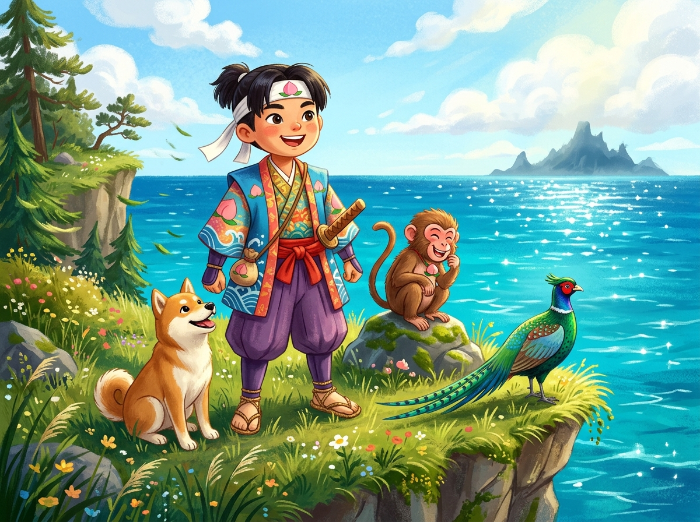

# မိုမိုတာရို (မက်မွန်သီးမှ မွေးဖွားသော သူရဲကောင်းလေး)

## ၁။ အစပျိုးခြင်း

ဟိုးရှေးရှေးတုန်းကပေါ့ကွယ်...
လှပတဲ့ ဂျပန်ပြည် တစ်နေရာက မြူခိုးတွေဝေနေတဲ့ တောင်ခြေရင်းလေးတစ်ခုမှာ ရွာလေးတစ်ရွာ ရှိသတဲ့။
အဲဒီရွာလေးမှာ ကောက်ပဲသီးနှံ စိုက်ပျိုးတဲ့ လယ်သမားတွေနဲ့ အမဲလိုက်သမားတွေ နေထိုင်ကြတယ်။
ရွာလေးရဲ့ အလယ်ကို ဖြတ်သန်းစီးဆင်းတဲ့ စမ်းချောင်းကလေးလည်း ရှိတာပေါ့။
နွေဦးရာသီဆို စမ်းချောင်းလေးနံဘေးမှာ အရောင်စုံတဲ့ တောပန်းကလေးတွေရယ်၊ ရွာဘေးနားက တလက်လက် တောက်ပနေတဲ့ စပါးခင်းတွေရယ်က အရမ်းကို လှပနေတာပေါ့။

ချစ်စဖွယ် ရွာလေးရဲ့ အစွန်အဖျားမှာတော့ သစ်သားအိမ်လေးတစ်လုံး ရှိတယ်။
အိမ်ကလေးဘေးမှာ တပိုင်တနိုင် စိုက်ပျိုးထားတဲ့ ဟင်းသီးဟင်းရွက် စိုက်ခင်းလေးလည်း ရှိတာပေါ့။
အဲဒီအိမ်ကလေးမှာ သဘောမနောကောင်းတဲ့ ထင်းခုတ်သမား အဘိုးအိုနဲ့ ဇနီးသည် အဘွားအိုတို့ နေထိုင်ကြတယ်။
သူတို့ရဲ့ သစ်သားအိမ်ငယ်လေးဟာ ရိုးစင်းပေမဲ့ မေတ္တာတရားတွေ၊ နွေးထွေးတဲ့ ရယ်မောသံတွေနဲ့ ထမင်းပူပူနွေးနွေးရဲ့ မွှေးပျံ့တဲ့ရနံ့တွေ အမြဲပြည့်နှက်နေခဲ့တယ်။
ဒါပေမဲ့ စမ်းချောင်းနံဘေးမှာ ရွာထဲက ကလေးငယ်တွေ ပုစဉ်းလေးတွေကို လိုက်ဖမ်းဆော့ကစားနေကြတာကို မြင်ရတဲ့အခါတိုင်း အဘွားအိုက ဝမ်းနည်းနေတတ်လေ့ရှိတယ်။
အဲဒီလိုအချိန်မျိုးဆို အဘိုးအိုက “ငါတို့မှာ ကလေးလေးတစ်ယောက်သာ ရရင်ကောင်းမှာပဲ” လို့ တိတ်တဆိတ် ဆုတောင်းလေ့ရှိသတဲ့။

အဲဒီလိုနဲ့ တစ်နေ့ကျတော့ သာယာတဲ့ မနက်ခင်းတစ်ခုမှာ အဘိုးအိုက ထင်းခုတ်ဖို့ တောင်ပေါ်တက်သွားချိန် အဘွားအိုကတော့ ကြည်လင်နေတဲ့ စမ်းချောင်းရေစပ်မှာ အဝတ်လျှော်ဖို့ ထွက်လာခဲ့တယ်။
အဝတ်လျှော်နေရင်းနဲ့ ရုတ်တရက် ရေစီးအတိုင်း တစ်ခုခု မျောပါလာတာကို တွေ့မိပါလေရော။
အဘွားအိုက သေချာကြည့်တော့မှ မျောလာတာက အလွန်ကြီးမားတဲ့ မက်မွန်သီးကြီးတစ်လုံး ဖြစ်နေတာပေါ့။
သာမန်မက်မွန်သီး မဟုတ်ဘဲ အရွယ်အစားက အလွန်ကြီးမားတဲ့အပြင် လှပတဲ့ အရောင်အသွေးနဲ့ မွှေးကြိုင်နေသတဲ့။
အဘွားအိုလည်း အံ့ဩဝမ်းသာသွားပြီး မက်မွန်သီးကြီးကို ဆယ်ယူပြီးတော့ ကျောမှာပိုးပြီး အိမ်ပြန်သယ်လာခဲ့တာပေါ့။

ညနေဘက် ထင်းခုတ်သွားတဲ့ အဘိုးအို အိမ်ပြန်ရောက်လာတော့မှ အဘွားအိုက ပြောတယ်—
“မောင်ကြီးရေ… ကျွန်မတော့ ဒီနေ့ အဝတ်သွားလျှော်ရင်း ချောင်းထဲက ဒီမက်မွန်သီးကြီးကို တွေ့လို့ ဆယ်ယူလာတာ။ ပုံပြင်ဒဏ္ဍာရီတွေထဲက နတ်ဥယျာဉ်ထဲက မက်မွန်သီးကြီးလား မသိဘူးတော်ရေ… ခွဲစားကြရအောင်” လို့ ပြောလိုက်သတဲ့ကွယ်။

အဘိုးအိုကလည်း မက်မွန်သီးကြီးကို ခွဲဖို့ မီးဖိုချောင်ထဲက ထက်နေအောင် သွေးထားတဲ့ ဓားတစ်ချောင်းကို ယူလိုက်ပြီး ခွဲဖို့ ထိလိုက်တယ်ဆိုရင်ပဲ ရုတ်တရက် မက်မွန်သီးထဲက အလင်းရောင်တွေ ဖြာထွက်လာပြီး နှစ်ခြမ်းကွဲသွားပါလေရော။
အဘိုးအိုနဲ့ အဘွားအိုလည်း တောက်ပတဲ့ အလင်းရောင်ကြောင့် မျက်စိတွေကို ဖုံးအုပ်ထားရင်း ကြမ်းပြင်ပေါ်ကို လဲကျကုန်သတဲ့။
ကြောက်လန့်လွန်းလို့ ငြိမ်နေတုန်းမှာပဲ ရုတ်တရက် ချစ်စဖွယ်ကောင်းတဲ့ “အူဝဲ… အူဝဲ” ဆိုတဲ့ ကလေးငိုသံလေးကို ကြားလိုက်ရပါလေရော။

အဘွားအိုက ရုတ်တရက် ကြမ်းပြင်ပေါ်ကနေ ခုန်ထပြီး ကလေးငိုသံကြားတဲ့ဘက်ကို အမြန်ကြည့်လိုက်တဲ့အခါ စားပွဲပေါ်က မက်မွန်သီးကြီးရဲ့ အလယ်မှာ မွေးကင်းစ ကလေးလေးတစ်ယောက် ရှိနေတာပေါ့။

“အလိုလေး… ချစ်ဖို့ကောင်းလိုက်တဲ့ ကလေးလေးပါလား။ ပါးလေးကလည်း ဖောင်းဖောင်းလေးတော်”
“ကျုပ်ကိုယ်တိုင်တောင် မယုံနိုင်ဘူး… အိပ်မက်များလားတော်ရေ၊ ထကြည့်စမ်းပါဦး” လို့ အဘွားအိုက ရေရွတ်လိုက်သတဲ့။

အဘိုးအိုက ကြမ်းပြင်ပေါ်ကနေ ထိုင်ကြည့်ပြီး ပြုံးနေတာပေါ့။ သူက ဒီလိုကလေးလေးတစ်ယောက်ရဖို့ ခိုးပြီး ဆုတောင်းခဲ့ရတာ မဟုတ်လား။ အဘွားအို ပျော်နေတာကို ကြည့်ပြီး ဒီကလေးလေးကို ဘာအကြောင်းကြောင့်ဖြစ်စေ မစွန့်ပစ်ဘဲ မွေးစားမယ်လို့ ဆုံးဖြတ်လိုက်တယ်လေ။

ကလေးလေးက သူ့ရဲ့ လက်သေးသေးလေးတွေကို ဆန့်တန်းပြီး ပျော်ရွှင်စွာ ရယ်ပြနေတာပေါ့။ အဘိုးအိုနဲ့ အဘွားအိုတို့လည်း ဝမ်းသာလွန်းလို့ ပါးရေတွန့်နေတဲ့ မျက်နှာပေါ်မှာ မျက်ရည်တွေ အပြည့်နဲ့ပေါ့ကွယ်။

အဘွားအိုက “မက်မွန်သီးထဲက မွေးဖွားလာတဲ့ သားငယ်လေးမို့ ‘မိုမိုတာရို’ လို့ နာမည်ပေးကြရအောင်။ ဒီနေ့ကစပြီး ငါတို့က မင်းရဲ့ အမေနဲ့ အဖေပဲ” လို့ ပျော်ရွှင်စွာ ပြောလိုက်သတဲ့။

နှစ်တွေကြာလာတာနဲ့အမျှ မိုမိုတာရိုဟာ တစ်နယ်လုံးက ကလေးတွေထက် ပိုပြီး ထွားကျိုင်းသန်မာလာခဲ့တယ်။
အသက်ဆယ့်ငါးနှစ်အရွယ် ရောက်တဲ့အခါ ကျောက်တုံးကြီးတွေကို အလွယ်တကူ မနိုင်တဲ့အထိ သန်မာလာသတဲ့။
မိုမိုတာရိုဟာ ကြင်နာစိတ်ရှိပြီး ရွာထဲက သက်ကြီးရွယ်အိုတွေအတွက် ခြင်းတောင်းတွေ၊ ဆန်အိတ်တွေကို အမြဲကူသယ်ပေးလေ့ရှိတာပေါ့။

## ၂။ ဖြစ်စဉ်ပျိုးခြင်း

တစ်နေ့မှာတော့ ကံမကောင်းလှစွာပဲ ကံဆိုးမိုးမှောင်ကျတဲ့ နေ့ရက်တွေ ရောက်လာခဲ့တယ်။
မုန်တိုင်းထန်ပြီး ကျောက်ဆောင်ထူထပ်တဲ့ ဘီလူးကျွန်း (Onigashima) ကနေ ကြောက်မက်ဖွယ်ရာ အိုနိ (Oni) ဘီလူးကြီးတွေ လှေကြီးတွေနဲ့ ရောက်လာကြတာပါ။
သံတင်းပုတ်ကြီးတွေကိုင်ပြီး ဟားတိုက်ရယ်မောကာ ကမ်းရိုးတန်းရွာတွေကို ဝင်ရောက်တိုက်ခိုက်ပြီး ကောက်ပဲသီးနှံ လယ်ယာစိုက်ခင်းတွေကို နင်းခြေ၊ ရွှေငွေရတနာတွေ၊ ပိုးထည်တွေနဲ့ ဘိုးဘွားပိုင် အမွေအနှစ်ပစ္စည်းတွေကို လုယက်ယူငင်သွားကြတယ်။ လူတွေကိုလည်း ရက်စက်စွာ ဒုက္ခပေးကြသတဲ့။

ရွာသူရွာသားတွေ ငိုကြွေးနေတာကို မြင်တဲ့အခါ မိုမိုတာရိုဟာ မွေးစားမိဘနှစ်ပါးရှေ့မှာ ဒူးထောက်လိုက်ပြီး—
“အမေနဲ့ အဖေ… အပြစ်မဲ့တဲ့ ပြည်သူတွေ ဒုက္ခရောက်နေတာကို သား လက်ပိုက်ကြည့်မနေနိုင်တော့ပါဘူး။ ဘီလူးကျွန်းကို သွားပြီး ဒီမကောင်းဆိုးဝါးတွေကို နှိမ်နင်းခွင့်ပြုပါ” လို့ ခွင့်တောင်းခဲ့တယ်။

မိဘနှစ်ပါးဟာ စိုးရိမ်စိတ်ကြောင့် တုန်လှုပ်နေကြပေမဲ့ သားဖြစ်သူဟာ ကြီးမြတ်တဲ့ တာဝန်ကို ထမ်းဆောင်ဖို့ မွေးဖွားလာသူမှန်း သိနေတော့ အဖေဖြစ်သူက ဘိုးဘွားစဉ်ဆက် လက်ဆင့်ကမ်းခဲ့တဲ့ သံမဏိဓားရှည်တစ်လက်နဲ့ မက်မွန်သီးတံဆိပ်ပါတဲ့ အလံတစ်ခုကို ပေးအပ်ခဲ့ပြီး အမေဖြစ်သူကတော့ သားအတွက် ဆန်မုန့်လုံးအချို (Kibi-Dango) တွေကို ကိုယ်တိုင်လုပ်ပြီး လမ်းမှာစားဖို့ အိတ်လေးနဲ့ ထည့်ပေးလိုက်တာပေါ့။

မိုမိုတာရိုက မိဘနှစ်ပါးကို ကန်တော့နှုတ်ဆက်ပြီးတော့ “ကျွန်တော် မရှိတဲ့အချိန်မှာ ကျန်းမာရေး ဂရုစိုက်ကြပါ။ အိမ်ကို အမြန်ဆုံး ပြန်လာခဲ့ပါမယ်” လို့ ပြောပြီး ခရီးထွက်လာခဲ့တယ်။
အမေဖြစ်သူ ထည့်ပေးလိုက်တဲ့ ဆန်မုန့်ချိုလုံးအိတ်ကို ခါးမှာချိတ်၊ အဖေဖြစ်သူ ပေးလိုက်တဲ့ ဓားရှည်နဲ့ အလံကို ကျောမှာပိုးပြီး တောင်အဆင်းလမ်းအတိုင်း ခရီးဆက်လာခဲ့သတဲ့။

တောင်ဆင်းလမ်း တစ်နေရာရောက်တော့ ထင်းရှူးပင်ကြီးတစ်ပင်နောက်ကနေ ဒေါသတကြီး မာန်ဖီနေတဲ့ တောခွေးကြီးတစ်ကောင် ခုန်ထွက်လာပါလေရော။

တောခွေးကြီးက ကျယ်လောင်စွာ မာန်ဖီလိုက်ပြီး—
“ဂါးးးး… ငါ့နယ်မြေကို ဖြတ်တဲ့ကောင်ကို ဆွဲဖြဲပြီး သတ်စားပစ်မယ်! ထွက်သွားစမ်း!” လို့ ဟိန်းဟောက်လိုက်သတဲ့။

မိုမိုတာရိုက တောခွေးကြီးကို တည်ငြိမ်စွာနဲ့ တည့်တည့်စိုက်ကြည့်ပြီးတော့—
“ငါက မိုမိုတာရိုပါ။ လူတွေကို လုယက်သတ်ဖြတ် စိုက်ခင်းတွေကို ဖျက်ဆီးပြီး အနိုင်ကျင့်နေတဲ့ ဘီလူးတွေကို အပြစ်ပေးဖို့ ဘီလူးကျွန်းကို သွားနေတာ။ ငါ့ဆီမှာ အမေထည့်ပေးလိုက်တဲ့ ကမ္ဘာပေါ်မှာ အရသာအရှိဆုံး ဆန်မုန့်ချိုလုံးလေးတွေ ပါလာတယ် သိလား” ဆိုပြီး မုန့်လုံးလေးတွေကို မြှောက်ပြလိုက်တာပေါ့။

ဆန်မုန့်ချိုလုံးလေးတွေရဲ့ ရနံ့က ချိုမြိန်မွှေးပျံ့နေတော့တာပဲ။

တောခွေးကြီးက နှာခေါင်းတရှုရှုနဲ့ အနံ့ခံကြည့်ပြီးတော့—
“အို… ဆန်မုန့်ဆိုတာ ဘယ်လိုမျိုးလဲ မွှေးလိုက်တာ။ မင်းလက်ထဲက ဆန်မုန့်ချိုလုံးလေး တစ်လုံးလောက် ငါ့ကို ကျွေးမယ်ဆိုရင် မင်းကို ငါ အသက်နဲ့လဲပြီး ကာကွယ်စောင့်ရှောက်ပါ့မယ်… တစ်လုံးလောက် ကျွေးပါလား” လို့ ပြောလိုက်သတဲ့။

မိုမိုတာရိုက ဝမ်းသာအားရနဲ့ လက်ခံလိုက်ပြီး ဆန်မုန့်ချိုလုံး တစ်လုံး ပေးလိုက်တယ်။
တောခွေးကြီးကလည်း သူ့ကတိအတိုင်း မိုမိုတာရိုနဲ့အတူ ခရီးဆက်လိုက်လာခဲ့တာပေါ့။

လမ်းခုလတ် တစ်နေရာကျတော့ လမ်းဘေးနားက သစ်ပင်ပေါ်ကနေ မျောက်တစ်ကောင်က တွဲလောင်းခိုဆင်းလာပြီး ခွေးကြီးကို မြင်တော့ အမွေးတွေထောင်ပြီး ရန်စောင်ပါလေရော။

မိုမိုတာရိုက အလျင်အမြန်ပဲ ခွေးနဲ့ မျောက်ကြားထဲက ဝင်ကာ ဟန့်တားပြီး ပြောလိုက်တယ်—
“စိတ်အေးအေးထားပါ ကိုမျောက်ရေ… ငါတို့က မင်းကို ရန်ပြုမဲ့သူတွေ မဟုတ်ပါဘူး။ ငါတို့က မတရား လုယက်အနိုင်ကျင့်ခံရတဲ့ ပြည်သူတွေအတွက် တရားမျှတမှုကို ရှာဖွေဖို့ ဘီလူးကျွန်းကို သွားကြမလို့ပါ” လို့ ရှင်းပြလိုက်တယ်။

ဉာဏ်ကောင်းတဲ့ မျောက်ကလေးက ခေါင်းကို တစ်ချက်ကုတ်ပြီး စူးစမ်းနေတုန်းမှာပဲ မိုမိုတာရိုရဲ့ ခါးမှာ ချိတ်ထားတဲ့ မုန့်အိတ်ကလေးကို တွေ့သွားပြီး အနံ့ခံလိုက်တယ်ပေါ့။

“ဟာ… မွှေးလိုက်တဲ့ အနံ့လေးပါလား။ အထဲက မုန့်တွေများလား…” လို့ စူးစမ်းလိုက်တယ်။

မိုမိုတာရိုက အိတ်ကလေးကို မြှောက်ပြရင်း—
“ဒါက ငါ့အမေ ထည့်ပေးလိုက်တဲ့ ကမ္ဘာပေါ်မှာ အရသာအရှိဆုံး ဆန်မုန့်ချိုလုံးလေးတွေပေါ့။ မင်းလိုချင်ရင် ဆန်မုန့်လုံး တစ်လုံး ပေးနိုင်ပါတယ်။ ငါတို့နဲ့အတူ ဘီလူးတွေကို ပညာပေးဖို့ လိုက်ခဲ့ပါလား” လို့ မုန့်လုံးတစ်လုံး ကမ်းပေးရင်း ဖိတ်ခေါ်လိုက်တယ်။

မျောက်ကလေးက မိုမိုတာရို ကမ်းပေးတဲ့ ဆန်မုန့်ချိုလုံးလေးကို တစ်ချက်ကြည့်ပြီး လှမ်းယူရင်း—
“ငါ ဒီမုန့်ကို လက်ခံလိုက်ပြီ။ မင်းတို့နဲ့အတူ ဘယ်လောက်ဆိုးတဲ့ ဘီလူးတွေပဲဖြစ်ပါစေ ငါ့ဉာဏ်ပညာကို သုံးပြီး အနိုင်ယူဖို့ လိုက်ခဲ့မယ်” လို့ ကတိပြုလိုက်သတဲ့။

သစ္စာရှိတဲ့ တောခွေးကြီးရယ်၊ ဉာဏ်ကောင်းတဲ့ မျောက်ကလေးရယ်၊ ကြင်နာတတ်တဲ့ မိုမိုတာရိုတို့ သုံးဦးဟာ မိတ်ဆွေဖွဲ့ပြီး ခရီးဆက်လာကြတယ်။
တောခွေးကြီးနဲ့ မျောက်ကလေး အချင်းများ ငြင်းခုံကြတိုင်း မိုမိုတာရိုက တစ်ဦးနဲ့တစ်ဦး နားလည်မှုမလွဲဘဲ ညီအစ်ကိုရင်းချာ စစ်သည်တော်တွေလို စည်းလုံးလာအောင် ညှိနှိုင်းပေးတာပေါ့။

အဲဒီလိုနဲ့ ခရီးဆက်လာလိုက်တာ လှိုင်းသံလေသံတွေ ဆူညံနေတဲ့ ပင်လယ်ကမ်းစပ်နားကို ရောက်လာကြပါလေရော။

ကမ်းစပ်နားမှာ ခဏနားဖို့ ပြင်ဆင်နေတုန်း ကောင်းကင်ပေါ်က စူးရှတဲ့ အသံတစ်ခုကို ကြားလိုက်ရတယ်။ အသံကြားတဲ့ဘက်ကို အမြန်ကြည့်လိုက်တော့ အလွန်လှပဝံ့ကြွားစွာ ပျံဝဲနေတဲ့ ရစ်ငှက်ကြီးတစ်ကောင် ဖြစ်နေတာပေါ့။

ရစ်ငှက်ကြီးက မြစိမ်းရောင်နဲ့ ရွှေဝါရောင် အတောင်ပံတွေကို ဖြန့်ကျက်ပြီး နေရောင်အောက်မှာ ပျံဝဲဆင်းလာရင်း—
“ဟားဟား… လူကလေးတစ်ယောက်၊ ခွေးကလေးတစ်ကောင်နဲ့ မျောက်ကလေးတစ်ကောင်ပါလား။ ထူးဆန်းတဲ့ အဖွဲ့လေးပဲကွ။ မင်းတို့ သုံးယောက်က ဘယ်သူတွေလဲ၊ ဘယ်ကို သွားကြမလို့လဲ” လို့ မေးလိုက်တယ်။

မိုမိုတာရိုက သူတို့ရဲ့ ခရီးစဉ်အကြောင်းကို ယဉ်ကျေးစွာ ရှင်းပြနေတာကို ငှက်ကြီးက ငြိမ်ပြီး နားထောင်နေတယ်။ ငှက်ကြီးရဲ့ စူးရှတဲ့ မျက်လုံးအစုံကလည်း မိုမိုတာရိုတို့ သုံးယောက်လုံးကို တစ်လက်မမကျန် အကဲခတ်နေတာပေါ့။

မိုမိုတာရိုက သူ့ဆီမှာကျန်တဲ့ နောက်ဆုံး ဆန်မုန့်ချိုလုံးလေးကို ပြရင်း—
“လှပဝံ့ကြွားလွန်းတဲ့ ရစ်ငှက်ကြီးရေ… ဒါက ငါ့ဆီမှာ နောက်ဆုံးကျန်တဲ့ ဆန်မုန့်ချိုလုံးလေးပဲ။ အမေ ထည့်ပေးလိုက်တဲ့ ကမ္ဘာပေါ်မှာ အရသာအရှိဆုံး ဆန်မုန့်ချိုလုံးလေးပေါ့။ မင်းလိုချင်ရင် ဒီဆန်မုန့်လုံးကို ပေးနိုင်ပါတယ်။ ငါတို့နဲ့အတူ ဘီလူးတွေကို ပညာပေးဖို့ လိုက်ခဲ့ပါလား” လို့ ဖိတ်ခေါ်လိုက်ပြန်တယ်။

ရစ်ငှက်ကြီးက ဆန်မုန့်ချိုလုံးလေးကို ကြည့်ပြီး နှုတ်သီးနဲ့ အသာအယာယူပြီး စားကြည့်လိုက်တယ်။
“ဘုရားရေ… ဒီလို နူးညံ့အရသာရှိတဲ့ ဆန်မုန့်လုံးလေးကို ငါ တစ်ခါမှ မစားဖူးပါလား။ ဟေ့ ကလေးလေး… ဘီလူးကြီးတွေကို အပြစ်ပေးဖို့အတွက် မင်းရဲ့ မျက်စိအဖြစ်ရော၊ အကာအကွယ် လှံသွားအဖြစ်ပါ ငါကူညီမယ်။ အရာအားလုံး ပြီးဆုံးသွားရင် အဘွားအိုရဲ့ အရသာရှိလှတဲ့ ဆန်မုန့်ချိုလုံးလေးတွေကို ထပ်မြည်းစမ်းပါရစေဦးနော်” လို့ ပြောလိုက်သတဲ့။

အဲဒီလိုနဲ့ မိုမိုတာရိုတို့ သူငယ်ချင်းလေးဦး အဖွဲ့လေးဟာ သစ်သားလှေလေးတစ်စင်းနဲ့ ဘီလူးကြီးတွေရှိတဲ့ ကျွန်းဆီကို ခရီးပြင်းနှင်ခဲ့ကြတာပေါ့။

## ၃။ အလှည့်အပြောင်း

လှိုင်းထန်လေပြင်း ကြမ်းတမ်းလှတဲ့ ပင်လယ်ခရီးကို ကျော်ဖြတ်လာခဲ့ကြပြီး နောက်ဆုံးမှာတော့ ဘီလူးကြီးတွေ နေထိုင်ရာ အိုနိဂါရှီးမား ကျွန်းဆီကို ရောက်ရှိလာပါလေရော။

ကျွန်းပေါ်မှာတော့ မတ်စောက်တဲ့ ကျောက်တံတိုင်းတွေနဲ့ ခံတပ်ကြီးတစ်ခု ရှိနေပြီး အလွန်ခိုင်ခံ့တဲ့ သံမဏိတံခါးကြီးတွေနဲ့ ပိတ်ထားသတဲ့။
အထဲကို ချောင်းကြည့်လိုက်တော့ ခိုးယူလုယက်ထားတဲ့ အစားအသောက်တွေ၊ အရက်သေစာတွေကို သောက်စားမူးယစ်ပြီး ကခုန်နေကြတဲ့ ဘီလူးနီ၊ ဘီလူးပြာကြီးတွေကို တွေ့ရတာပေါ့။

မိုမိုတာရိုနဲ့ သူငယ်ချင်းတွေက ကျောက်ဆောင်နောက်မှာ အကာအကွယ်ယူပြီး ဘယ်လို စနစ်တကျ တိုက်ခိုက်ကြမလဲဆိုတာ သေချာတိုင်ပင် နေရာယူလိုက်ကြတယ်။
အဆင်သင့်ဖြစ်တာနဲ့ မိုမိုတာရိုက မက်မွန်သီးပုံ အလံကို ကျောမှာ လွှင့်ထူပြီး ရစ်ငှက်ကြီးကို အချက်ပြလိုက်ကာ တိုက်ပွဲကို စတင်လိုက်ကြပါတော့တယ်။

ပထမဦးဆုံး ရစ်ငှက်ကြီးဟာ မီးမြားတစ်စင်းလို ကောင်းကင်ပေါ် ပျံတက်သွားပြီး ဘီလူးတွေရဲ့ မျက်လုံးတွေဆီကို အရှိန်အဟုန်ပြင်းပြင်းနဲ့ ထိုးဆင်းတိုက်ခိုက်ကာ ကင်းစောင့်တွေကို အာရုံလွှဲလိုက်တယ်။

အံ့ဩထိတ်လန့်နေတဲ့ ဘီလူးကြီးတွေ မလှုပ်ရှားနိုင်ခင်မှာပဲ မျောက်ကလေးက မတ်စောက်တဲ့ ကျောက်တံတိုင်းကြီးပေါ် လျှပ်စီးလက်သလို အမြန်ဆုံး တွယ်တက်သွားပြီး အတွင်းဘက်ကနေ လေးလံလှတဲ့ သံမဏိတံခါးမင်းတုပ်ကြီးကို ဖြုတ်ချဖွင့်လှစ်ပေးလိုက်တာပေါ့။

မိုမိုတာရိုနဲ့ တောခွေးကြီးကလည်း ရဲရင့်စွာ ကြုံးဝါးပြီး တံခါးကြီးကို ကန်ဖွင့်ကာ အထဲကို ပြေးဝင်သွားပြီး စတင်တိုက်ခိုက်ကြတော့တယ်။
တောခွေးကြီးက ရှေ့ဆုံးကနေ ခုန်အုပ်လိုက်ပြီး ဘီလူးပြာကြီးတွေရဲ့ ခြေချင်းဝတ်တွေကို အားကုန်ကိုက်ခဲလိုက်ရာ ဘီလူးကြီးတွေဟာ သစ်ပင်ကြီးတွေ လဲပြိုသလို မြေပြင်ပေါ် ဝုန်းခနဲ လဲကျကုန်ကြသတဲ့။
မျောက်ကလေးက ဘီလူးတွေရဲ့ ကျောပေါ် ခုန်တက်ပြီး ဆံပင်တွေကို ဆွဲဆောင့်ကာ သံတင်းပုတ်တွေကို လုယူပစ်သလို၊ ရစ်ငှက်ကြီးကလည်း လေထဲကနေ ဖြတ်သန်းပျံဝဲရင်း ရန်သူတွေ ဟန်ချက်ပျက်အောင် တိုက်ခိုက်နေခဲ့တာပေါ့။

## ၄။ အဖြေထွက်ခြင်း

ခံတပ်ရဲ့ အလယ်ဗဟိုမှာတော့ ကျားရေဝတ်ရုံကို ဝတ်ဆင်ထားပြီး သစ်ပင်ပင်စည်လောက် ကြီးမားတဲ့ သံတင်းပုတ်ကြီးကို ကိုင်ထားတဲ့ ဦးချိုကြီးတွေနဲ့ ဘီလူးခေါင်းဆောင်ကြီးက အမျက်ခြောင်းခြောင်းထွက်ပြီး မိုမိုတာရိုတို့ကို လိုက်ရှာပါလေရော။

“ဘယ် မလောက်လေးမလောက်စားကောင်က ငါ့ခံတပ်ကို ကျူးကျော်တာလဲကွ!” လို့ ဒေါသတကြီး အော်ဟစ်ဆဲဆိုလိုက်သတဲ့။

မိုမိုတာရိုနဲ့ သူငယ်ချင်းတွေက စည်းလုံးညီညွတ်စွာ ပူးပေါင်းပြီး ဘီလူးခေါင်းဆောင်ကြီးကို ဝိုင်းဝန်းတိုက်ခိုက်ကြတာပေါ့။

ဒေါသထွက်နေတဲ့ ဘီလူးခေါင်းဆောင်ကြီးက မြေကြီးပါ နှစ်ခြမ်းကွဲမတတ် အားအင်အပြည့်နဲ့ တင်းပုတ်ကြီးကို လွှဲရမ်းထုရိုက်နေတော့ အနီးအနားက ကျောက်တုံးကျောက်ဆောင်တွေပါ တဖျစ်ဖျစ် ကွဲကြေကုန်သတဲ့။
ဒါပေမဲ့ စည်းလုံးညီညွတ်တဲ့ မိုမိုတာရိုတို့ကို ဘယ်ယှဉ်နိုင်ပါ့မလဲ။ မိုမိုတာရိုက ဘီလူးခေါင်းဆောင်ကြီးရဲ့ တင်းပုတ်လွှဲချက်တွေကို လျင်မြန်စွာ ရှောင်တိမ်းပြီး အဆက်မပြတ် တိုက်ခိုက်တာပေါ့။

တောခွေးကြီးနဲ့ မျောက်ကလေးကလည်း ကြိုးတွေကို ကိုက်ဆွဲပြီး ဘီလူးကြီးရဲ့ ခြေထောက်တွေကို ပတ်ပြေးတိုက်ခိုက်ကာ ခြေချုပ်မိအောင် ထောင်ချောက်ဆင်ကြတယ်။
ရစ်ငှက်ကြီးကလည်း မိုမိုတာရိုကို အဆက်မပြတ် အကာအကွယ်ပေးပြီး ဘီလူးခေါင်းဆောင်ကြီးရဲ့ မျက်လုံးတွေကို အရှိန်ပြင်းစွာ ထိုးဆိတ်တိုက်ခိုက်ပေးနေတာပေါ့။

အဲဒီအချိန်မှာ မိုမိုတာရိုက ဘီလူးခေါင်းဆောင်ကြီးရဲ့ တင်းပုတ်ထုချက်ကို လှစ်ခနဲ ခုန်ရှောင်ရင်း အားကုန်သုံးပြီး အထက်ကို ခုန်တက်လိုက်သတဲ့။

တိုင်ပင်ထားတဲ့အတိုင်း ရစ်ငှက်ကြီးက ခုန်ထွက်လာတဲ့ မိုမိုတာရိုကို အမိအရ ဖမ်းချီပြီး ဘီလူးခေါင်းဆောင်ကြီးရဲ့ လည်ဂုတ်ပေါ်ကို ပစ်ချပေးလိုက်တယ်။
မိုမိုတာရိုကလည်း အခွင့်အရေးကို အမိအရယူပြီး ဘီလူးခေါင်းဆောင်ကြီးကို ဓားနဲ့ ချိန်မိုးကာ—
“ငါတို့ နိုင်ပြီဟေ့! အသေခံမလား… အရှုံးပေးမလား!” လို့ ကြုံးဝါးဟစ်ကြွေးလိုက်တာပေါ့။

ဘီလူးခေါင်းဆောင်ကြီးလည်း အလွန်တရာ တုန်လှုပ်ချောက်ချား ကြောက်ရွံ့သွားပြီး ဒူးထောက်ချကာ တောင်းပန်ပါတော့တယ်။

“မြင့်မြတ်ပြီး သနားကြင်နာတတ်တဲ့ မိုမိုတာရိုရေ… ကျွန်ုပ်တို့ရဲ့ အသက်ကို ချမ်းသာပေးပါ။ အရှုံးပေးပါပြီ။ လုယူထားတဲ့ ရွှေဒင်္ဂါးတွေ၊ ကျောက်မျက်ရတနာတွေနဲ့ ပိုးထည်အားလုံးကို တစ်ခုမကျန် ပြန်ပေးပါ့မယ်။ နောင်ဘယ်တော့မှ လူသားတွေကို ဒုက္ခမပေးတော့ပါဘူးလို့ ကောင်းကင်ဘုံကို တိုင်တည်ပြီး ကတိပြုပါတယ်။ ကျွန်ုပ်တို့ကို ခွင့်လွှတ်ပါ” လို့ ဒူးထောက်တောင်းပန် ကတိပြုလိုက်သတဲ့ကွယ်။

## ၅။ နိဂုံး

အဲဒီလိုနဲ့ မိုမိုတာရိုနဲ့ မိတ်ဆွေသုံးဦးတို့ဟာ ဘီလူးကြီးတွေကိုယ်တိုင် ပြန်လိုက်ပို့ပေးတဲ့ လှည်းတွေပေါ်မှာ လုယူခံထားရတဲ့ ပစ္စည်းတွေကို အပြည့်တင်ဆောင်ပြီး ပြန်လာခဲ့ကြတယ်။
ရွာကို ပြန်ရောက်တဲ့အခါ ပစ္စည်းတွေကို ပိုင်ရှင်တွေဆီ မပျက်မကွက် ပြန်လည်ပေးအပ်ခဲ့ကြတာပေါ့။ ဝမ်းသာပျော်ရွှင်နေကြတဲ့ ပြည်သူတွေရဲ့ ကြွေးကြော်သံတွေက တောင်တန်းတွေတစ်လျှောက် ပဲ့တင်ထပ်သွားတော့တာပဲ။

နောက်ဆုံးမှာတော့ မိုမိုတာရိုဟာ ကျေးရွာလေးဆီ ပြန်ရောက်ပြီး ချစ်လှစွာသော မိဘနှစ်ပါးနဲ့အတူ ဆန်မုန့်ချိုလုံးလေးတွေ အတူတူလုပ်စားရင်း၊ သစ္စာရှိ မိတ်ဆွေတွေနဲ့အတူ အေးချမ်းသာယာစွာ နေထိုင်သွားကြပါတော့သတဲ့ကွယ်။

---

## သင်ခန်းစာ

မိမိရှိသောအရာကို ဝေမျှကျွေးမွေးခြင်းဖြင့် မိတ်ဆွေစစ်များကို ရရှိနိုင်သလို၊ မတူညီသော စွမ်းရည်များကို စည်းလုံးညီညွတ်စွာ ပေါင်းစည်းလိုက်ပါက မည်မျှကြီးမားသော အခက်အခဲကိုမဆို အောင်နိုင်နိုင်သည်။ ထို့အပြင် စစ်မှန်သော သူရဲကောင်းဆိုသည်မှာ အနိုင်ရချိန်၌ပင် အရှုံးပေးသူအပေါ် ကရုဏာတရား ထားရှိတတ်သူ ဖြစ်သည်။
