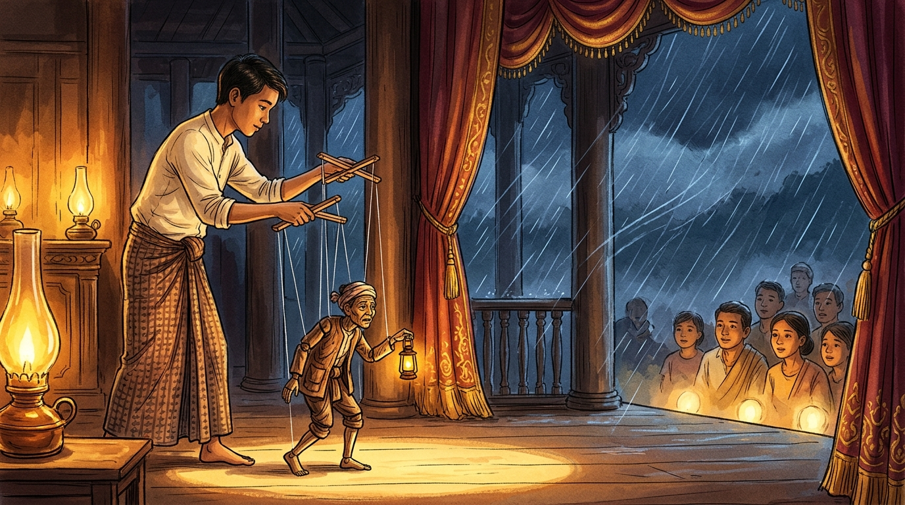

# မန္တလေး ရုပ်သေးစင်ပေါ်က လက်တုန်သမား ကိုလှိုင်

## ၁။ အစပျိုးခြင်း

မန္တလေးမြို့စွန်က ရုပ်သေးစင်ကြီးပေါ်မှာ ဆီမီးခွက်တွေ တဖျစ်ဖျစ် တောက်လောင်နေတဲ့ ညနေခင်းတိုင်း ယမနေသား ရုပ်သေးရုပ်နံ့နဲ့ သနပ်ခါးနံ့က ရောယှက်မွှေးပျံ့နေတတ်တာပေါ့။ ဆိုင်းဝိုင်းကြီးက အစမ်းတီးလိုက်တိုင်း ကန့်လန့်ကာနောက်ကွယ်မှာ ကြိုးဆွဲသမားလေးတွေ ပျားပန်းခတ် လှုပ်ရှားနေကြလေရဲ့။ အဲဒီအဖွဲ့ထဲမှာ အသက်အငယ်ဆုံး ကြိုးဆွဲတပည့်လေး ကိုလှိုင်ကတော့ စိတ်အားထက်သန်သလောက် စိတ်ညစ်စရာတစ်ခု ရှိနေရှာတယ်။

ကိုလှိုင်ဟာ ရုပ်သေးပညာကို ရူးသွပ်ပေမယ့် လေးလံတဲ့ ကြက်ခြေခတ် ကြိုးတန်းကို ကိုင်လိုက်တိုင်း သူ့ညာဘက်လက်ကောက်ဝတ်က အလိုလို တဆတ်ဆတ် တုန်နေတတ်တာပဲ။ တစ်ဖက်က ဆရာတူတပည့် မောင်ဝင်းကတော့ ကျောက်သားလို ငြိမ်သက်တိကျတဲ့ လက်ပိုင်ရှင်ဆိုတော့ မင်းသားရုပ်၊ ဘုရင်ရုပ်တွေကို ကိုင်လိုက်တိုင်း ကျက်သရေရှိလိုက်တာမှ ပြောစရာမလိုဘူးပေါ့။

## ၂။ ဖြစ်စဉ်ပျိုးခြင်း

ပွဲဦးထွက် အစမ်းလေ့ကျင့်တဲ့ ညနေမှာတော့ ဆရာကြီး ဦးတင်အောင်က ကိုလှိုင်ကို ဝန်ကြီးရုပ် ခဏ ကိုင်ခိုင်းကြည့်သတဲ့။ မောင်ဝင်းရဲ့ ဘုရင်ရုပ်ကြီးက ဟန်ပါပါ မာတောင့်တောင့်နဲ့ ခံ့ညားနေချိန်မှာ ကိုလှိုင် ကိုင်ထားတဲ့ ဝန်ကြီးရုပ်ကတော့ ခေါင်းပေါင်းစလေး တလှုပ်လှုပ်နဲ့ အဖျားတက်နေသလို တုန်ယင်နေတော့တာပဲ။ ကန့်လန့်ကာနောက်က လူငယ်တချို့က ဟက်ဟက်ပက်ပက် ရယ်မောကြသလို မောင်ဝင်းကလည်း နှာခေါင်းရှုံ့ပြီး လက်ပိုက်ကြည့်နေလေရဲ့။

ဆရာကြီး ဦးတင်အောင်ကတော့ သက်ပြင်းချပြီး "တော်ပြီ ကိုလှိုင်ရေ... မင်းသားခန်းမှာ လက်တုန်နေရင် ဘုရင့်နန်းတော်က ငလျင်လှုပ်နေသလို ဖြစ်ကုန်လိမ့်မယ်။ မင်းက နောက်က မီးခွက်နဲ့ လှိုင်းပိတ်စပဲ ကိုင်တော့ကွယ်" လို့သာ ညင်ညင်သာသာ ပြောရှာတယ်။ ကိုလှိုင်ခမျာ မျက်နှာလေး ငုံ့ပြီး မီးခွက်တိုင်ဘေး တိတ်တဆိတ် ဆုတ်သွားရရှာတယ်ပေါ့။

## ၃။ အလှည့်အပြောင်း

အဲဒီလိုနဲ့ ဘုရားပွဲတော်ကြီး နောက်ဆုံးည ရောက်လာပါရော့လား။ ပရိသတ်တွေ ရုံပြည့်ရုံလျှံ စည်ကားနေတုန်း မမျှော်လင့်ဘဲ မိုးသက်လေပြင်းကြီး ဝေါခနဲ ဝင်တိုက်လာတော့တာပဲ။ ကောင်းကင်မှာ မိုးခြိမ်းသံ ဂျိန်းခနဲ မြည်ဟည်းပြီး မိုးပေါက်ကြီးတွေက စင်ခေါင်မိုးပေါ် တဝေါဝေါ ရွာချလိုက်တာ စင်ပေါ်က ကန့်လန့်ကာစတွေတောင် တဖြန်းဖြန်း လွင့်ခါကုန်လေရဲ့။ ဇာတ်လမ်းအလှည့်ကလည်း ပရိသတ် အသည်းနှလုံးကို ဆွဲဆောင်ရမယ့် "မုန်တိုင်းထဲ သားပျောက်ရှာတဲ့ လှေသမားအဘိုးအို" အခန်းပေါ့။

မောင်ဝင်းက သူ့ရဲ့ နာမည်ကျော် တိကျငြိမ်သက်တဲ့ လက်တွေနဲ့ အဘိုးအိုရုပ်ကို ကိုင်ပြီး စင်ပေါ် ထွက်ကပြသတဲ့။ ဒါပေမဲ့ မုန်တိုင်းလေသံ တဝေါဝေါကြားမှာ မောင်ဝင်းရဲ့ အဘိုးအိုရုပ်က သိပ်ကို တည်ငြိမ်လွန်းနေတာမို့ ချမ်းတုန်နေတဲ့ လူအိုနဲ့ မတူဘဲ သစ်သားတုံး မာတောင့်တောင့်ကြီး စင်ပေါ် ရပ်နေသလို ဖြစ်နေတော့တာပဲ။ ပရိသတ်က မျက်လုံးအဝိုင်းသားနဲ့ ငေးကြည့်ရုံပဲ ရှိပြီး ရင်ထဲ မထိဘဲ ငြီးငွေ့သလို လှုပ်လှုပ်ရွရွ ဖြစ်လာလေရဲ့။ ဆရာကြီး ဦးတင်အောင်က အခြေအနေမဟန်တာ မြင်တော့ မီးခွက်ဘေးက ကိုလှိုင်ကို လှမ်းဆွဲပြီး "ဟေ့ ကိုလှိုင်... အခုချက်ချင်း ဝင်လဲဆွဲစမ်း" လို့ အသံမာမာနဲ့ အမိန့်ပေးလိုက်တော့တယ်။

## ၄။ အဖြေထွက်ခြင်း

ကိုလှိုင်လည်း ကြောက်စိတ်နဲ့ လက်ပိုတုန်မသွားအောင် ကြက်ခြေခတ်ကို အားကုန် ညှစ်ကိုင်ကြည့်သေးတယ်။ ဒါပေမဲ့ သူ အတင်းထိန်းလေလေ ကြိုးတွေက ပိုကျပ်ပြီး အရုပ်က ပိုတောင့်လေ ဖြစ်နေရှာတာပေါ့။ အပြင်ဘက်က မိုးသံနဲ့ ပတ်မကြီးသံ တဒုန်းဒုန်း ရင်ဘတ်ထဲ လာရိုက်ခတ်တဲ့အခါကျမှ ကိုလှိုင်ဟာ သူ့လက်ကို ချုပ်တည်းထားတာ လျှော့ချပြီး မုန်တိုင်းစည်းချက်ထဲ စိတ်ကို လွှတ်ပေးလိုက်တော့တာပဲ။

ချက်ချင်းဆိုသလိုပဲ သူ့လက်ကောက်ဝတ်က သဘာဝ တုန်ခါမှုလေးဟာ ချည်ကြိုးလေးတွေကနေတစ်ဆင့် ရုပ်သေးရုပ်ဆီ တလှုပ်လှုပ် စီးဆင်းသွားလေရဲ့။ အဘိုးအိုရုပ်ရဲ့ ပခုံးလေးဟာ လေအေးဒဏ်ကြောင့် ဆတ်ခနဲ ကျုံ့တက်သွားတယ်။ မီးအိမ်ကိုင်ထားတဲ့ လက်တံလေးက ချမ်းတုန်သလို တဆတ်ဆတ် လှုပ်ခါပြီး သားကို ခေါ်နေတဲ့ ဦးခေါင်းလေးက ဝမ်းနည်းစိတ်နဲ့ ညင်ညင်သာသာ တုန်ယင်နေရှာတော့တာပေါ့။ သစ်သားရုပ်သေးလေးက အသက်ဝင်လာသလို ဖြစ်သွားတာမို့ တစ်ရုံလုံး အသံတိတ်ဆိတ်သွားပြီး ရှေ့တန်းက အမယ်အိုတွေတောင် မျက်ရည်သုတ်ကုန်ကြသတဲ့။

## ၅။ နိဂုံး

ကန့်လန့်ကာ ပိတ်ချလိုက်ချိန်မှာတော့ ပရိသတ်ရဲ့ လက်ခုပ်သံဟာ အပြင်က မိုးခြိမ်းသံကို ဖုံးလွှမ်းသွားအောင် ဂျိန်းခနဲ ထွက်ပေါ်လာတော့တာပဲ။ မောင်ဝင်းက သူ့ရဲ့ ငြိမ်သက်နေတဲ့ လက်ဖဝါးတွေကို ငုံ့ကြည့်ပြီးနောက် ကိုလှိုင်ဘက် လှည့်ကာ ခေါင်းတညိတ်ညိတ် လုပ်ပြရှာတယ်။ ဆရာကြီး ဦးတင်အောင်ကတော့ ကိုလှိုင်ပခုံးကို ပုတ်ပြီး "မင်းသားမင်းသမီး အခန်းကျ မောင်ဝင်း ဆွဲပါစေကွာ... ဒါပေမဲ့ လေမုန်တိုင်းနဲ့ ရင်ထဲက ခံစားချက် အသက်ဝင်ရမယ့် အခန်းဆိုရင်တော့ မင်းရဲ့ တုန်နေတဲ့ လက်မှ ဖြစ်မှာ ကိုလှိုင်ရေ" လို့ ပြုံးပြီး ပြောလိုက်လေရဲ့။ ကိုလှိုင်လည်း ခပ်ဖွဖွ တုန်နေဆဲ ညာလက်ကလေးကို ကြည့်ပြီး ပထမဆုံးအကြိမ် အေးအေးချမ်းချမ်း ပြုံးလိုက်မိတော့တာပေါ့။

---

## သင်ခန်းစာ

နေရာတိုင်းနဲ့ မကိုက်ညီတဲ့ အားနည်းချက်တစ်ခုဟာ သူ့အတွက် မှန်ကန်တဲ့ နေရာနဲ့ ကြုံတဲ့အခါ ဘယ်သူမှ တုပလို့မရတဲ့ အသက်ဝင်မှု ဖြစ်လာတတ်တယ်။ ကိုယ့်ချို့ယွင်းချက်ကို အတင်းဖုံးကွယ် ငြင်းဆန်နေမယ့်အစား ဘယ်နေရာမှာ အသုံးဝင်နိုင်မလဲဆိုတာ ရှာဖွေတတ်ဖို့ပဲ လိုတာပါ။
